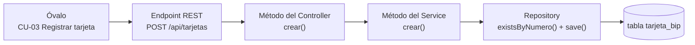
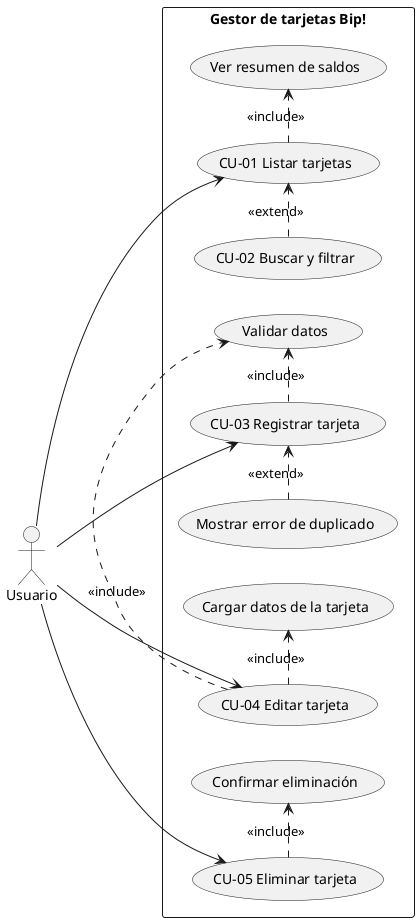

# 00 · Diagrama UML de casos de uso (antes de construir)

> **Primero se diseña, después se programa.** Este diagrama es lo primero que se hace en un proyecto:
> responde *"¿qué necesita poder hacer el usuario?"* antes de pensar en clases, tablas o pantallas.

## 1. El diagrama

*(Si tu visor no muestra la imagen, abre directamente [img/casos-de-uso.svg](img/casos-de-uso.svg) en el navegador.)*

## 2. ¿Cómo se lee? (la teoría)

El dibujo tiene solo **cuatro tipos de elementos**:

| Elemento | Cómo se dibuja | Qué significa |
|---|---|---|
| **Actor** | El **monito** (persona de palitos) | Quien **usa** el sistema desde afuera. No es una clase: es un *rol*. Aquí hay uno solo: el **Usuario**, porque no hay login ni más perfiles |
| **Caso de uso** | Un **óvalo** (las "esferas" o "globos") | Un **objetivo que el usuario quiere lograr** con el sistema, nombrado con un verbo: *Registrar tarjeta*, *Eliminar tarjeta* |
| **Límite del sistema** | El **rectángulo grande** | Lo que está *dentro* del sistema que construimos. El actor siempre queda **afuera** |
| **Relaciones** | **Líneas** entre los elementos | Ver tabla siguiente |

### Tipos de relación

| Línea | Nombre | Significado | Ejemplo del proyecto |
|---|---|---|---|
| ─────── (continua, sin flecha) | **Asociación** | "El actor participa en este caso de uso" | Usuario — Registrar tarjeta |
| - - - ▶ **«include»** | **Inclusión** | El caso de uso **siempre** necesita al otro para completarse (obligatorio) | *Registrar* incluye *Validar datos*; *Eliminar* incluye *Confirmar eliminación* |
| - - - ▶ **«extend»** | **Extensión** | El otro caso de uso **a veces** se agrega (opcional, solo bajo cierta condición) | *Buscar y filtrar* extiende *Listar*; *Mostrar error de duplicado* extiende *Registrar* (solo si el número ya existe) |

> **Truco para no confundir `include` y `extend`:**
> **include = siempre** ("para registrar *siempre* hay que validar").
> **extend = a veces** ("al registrar, *a veces* hay un duplicado").
> La flecha de **include** sale del caso principal hacia el incluido; la de **extend** sale del opcional hacia el principal.

## 3. ¿Cada esfera es un método?

**No exactamente.** Un óvalo es un **objetivo del usuario** (algo que *quiere hacer*), no una pieza de código. Lo que sí ocurre es que, cuando se programa, **cada caso de uso principal se convierte en una "cadena" de piezas**:

En un CRUD simple como este, **un óvalo principal ≈ un endpoint ≈ un método del service**. Pero hay matices:

| Óvalo | ¿Es un método propio? | Cómo se implementa de verdad |
|---|---|---|
| CU-01 Listar tarjetas | **Sí** | `GET /api/tarjetas` → `service.listar()` |
| CU-02 Buscar y filtrar | **No** | Lo hace **Angular** en memoria (`computed` sobre la lista ya cargada); el backend no se entera |
| Ver resumen de saldos | **No** | Lo calcula **Angular** (total, activas, saldo total) a partir de la lista |
| CU-03 Registrar tarjeta | **Sí** | `POST /api/tarjetas` → `service.crear()` |
| Validar datos | **No** (no hay un método "validar") | Son **anotaciones** (`@NotBlank`, `@Pattern`, `@DecimalMax`) en el DTO + `@Valid` en el controller + los `CHECK` de la base |
| Mostrar error de duplicado | **No** | El service lanza `NumeroTarjetaDuplicadoException` → `GlobalExceptionHandler` responde **409** → Angular muestra el mensaje |
| CU-04 Editar tarjeta | **Sí** | `PUT /api/tarjetas/{id}` → `service.actualizar()` |
| Cargar datos de la tarjeta | **Sí** (reutilizado) | `GET /api/tarjetas/{id}` → `service.obtener()` |
| CU-05 Eliminar tarjeta | **Sí** | `DELETE /api/tarjetas/{id}` → `service.eliminar()` |
| Confirmar eliminación | **No** | Es un **diálogo en Angular** (`ConfirmDialog`, lo abre `TarjetasPage`); no llega al servidor |

**Regla práctica:** el diagrama te dice **qué** hace el sistema; los métodos, clases y tablas son el **cómo**, y se deciden después.

## 4. Especificación de cada caso de uso

El diagrama muestra *qué* casos existen; la **especificación** cuenta *cómo ocurre* cada uno paso a paso. Es lo que usarás para programar y para probar.

### CU-01 · Listar tarjetas

| Campo | Detalle |
|---|---|
| **Actor** | Usuario |
| **Objetivo** | Ver todas sus tarjetas con saldo y estado |
| **Precondición** | El sistema está en funcionamiento |
| **Flujo principal** | 1. El usuario abre la aplicación. 2. El sistema muestra el resumen (cantidad, activas, saldo total). 3. El sistema muestra las tarjetas, las más nuevas primero |
| **Flujo alternativo** | *A1.* No hay tarjetas → se muestra *"Aún no tienes tarjetas"* con un botón para registrar la primera. *A2.* El servidor no responde → mensaje *"No hay conexión con el servidor"* con botón Reintentar |
| **Postcondición** | El usuario ve el estado actual de sus tarjetas |
| **Reglas** | RF-02, RF-06 |

### CU-02 · Buscar y filtrar tarjetas *(extiende CU-01)*

| Campo | Detalle |
|---|---|
| **Cuándo ocurre** | Solo si el usuario escribe en el buscador o elige un estado |
| **Flujo** | 1. El usuario escribe texto (número, titular o alias) y/o elige *Activas*/*Bloqueadas*. 2. El sistema muestra solo las tarjetas que coinciden |
| **Alternativo** | Nada coincide → *"Ninguna tarjeta coincide con la búsqueda"* |
| **Reglas** | RF-03 |

### CU-03 · Registrar tarjeta

| Campo | Detalle |
|---|---|
| **Actor** | Usuario |
| **Precondición** | Ninguna |
| **Flujo principal** | 1. El usuario presiona *+ Nueva tarjeta*. 2. Ingresa número, titular, alias (opcional), tipo y saldo. 3. Presiona *Registrar tarjeta*. 4. El sistema **valida los datos** (incluye *Validar datos*). 5. El sistema verifica que el número no exista. 6. El sistema guarda la tarjeta como **ACTIVA**. 7. El sistema vuelve al listado y avisa *"Tarjeta registrada"* |
| **Flujo alternativo** | *A1 (paso 4).* Datos inválidos → el sistema indica qué campo corregir y no guarda. *A2 (paso 5).* El número ya existe → *«extend»* **Mostrar error de duplicado**: *"Ya existe una tarjeta registrada con el número …"* |
| **Postcondición** | Existe una tarjeta nueva en la base de datos |
| **Reglas** | RF-01, RN-01, RN-02, RN-04, RN-05, RN-06, RN-07 |

### CU-04 · Editar tarjeta

| Campo | Detalle |
|---|---|
| **Actor** | Usuario |
| **Precondición** | La tarjeta existe |
| **Flujo principal** | 1. El usuario presiona *Editar* en una tarjeta. 2. El sistema **carga los datos de la tarjeta** (incluye *Cargar datos*). 3. El número aparece bloqueado. 4. El usuario modifica titular, alias, tipo, saldo o estado. 5. Presiona *Guardar cambios*. 6. El sistema valida (incluye *Validar datos*) y guarda. 7. Vuelve al listado y avisa *"Tarjeta actualizada"* |
| **Flujo alternativo** | *A1.* La tarjeta ya no existe (otra persona la eliminó) → **404** *"No existe una tarjeta con id …"*. *A2.* Datos inválidos → se indica el campo a corregir |
| **Postcondición** | Los datos de la tarjeta quedan actualizados; el número no cambia |
| **Reglas** | RF-04, RN-03, RN-04, RN-05 |

### CU-05 · Eliminar tarjeta

| Campo | Detalle |
|---|---|
| **Actor** | Usuario |
| **Precondición** | La tarjeta existe |
| **Flujo principal** | 1. El usuario presiona *Eliminar*. 2. El sistema pide **confirmación** (incluye *Confirmar eliminación*). 3. El usuario confirma. 4. El sistema elimina la tarjeta. 5. El listado se actualiza y avisa *"Tarjeta eliminada"* |
| **Flujo alternativo** | *A1.* El usuario cancela → no pasa nada. *A2.* La tarjeta ya no existe → **404** |
| **Postcondición** | La tarjeta deja de existir en la base de datos |
| **Reglas** | RF-05 |

## 5. Del diagrama al plan de construcción

Los casos de uso sirven también para **planificar el desarrollo y las pruebas**:

| Caso de uso | Se construye en el… | Se prueba en… |
|---|---|---|
| Base común (tabla, Entity, Repository) | Pasos 2 a 5 de la [guía completa](GUIA-COMPLETA-PASO-A-PASO.md) | Hibernate valida al levantar |
| CU-01, CU-03, CU-04, CU-05 y *Cargar datos* | Paso 6 (Controller) | Las 10 pruebas de Swagger |
| CU-02, *Ver resumen*, *Confirmar eliminación* | Angular (`TarjetasPage` y sus componentes) | Recorrido en el navegador |

## 6. ¿Cómo se construye un diagrama de casos de uso? (para tus propios proyectos)

1. **Define el límite del sistema:** ¿qué incluye y qué no? (aquí: sin login, sin recargas reales).
2. **Identifica los actores:** ¿quién usa el sistema? (aquí: un Usuario).
3. **Lista los objetivos de cada actor** con verbos: *registrar, editar, eliminar, listar*. Cada objetivo = un óvalo.
4. **Busca lo obligatorio dentro de cada objetivo** → `«include»` (validar, confirmar).
5. **Busca lo opcional o excepcional** → `«extend»` (buscar, mostrar error).
6. **Escribe la especificación** de cada caso principal (tabla de la sección 4).
7. **Verifica contra los requerimientos** ([01 · Problema](01-problema.md)): cada RF debe estar cubierto por algún óvalo.

| Requerimiento | Caso de uso que lo cubre |
|---|---|
| RF-01 Registrar | CU-03 |
| RF-02 Listar | CU-01 |
| RF-03 Buscar y filtrar | CU-02 |
| RF-04 Editar | CU-04 |
| RF-05 Eliminar con confirmación | CU-05 |
| RF-06 Resumen | *Ver resumen de saldos* (incluido en CU-01) |

## 7. Código fuente PlantUML (opcional)

Si quieres editar el diagrama con una herramienta (por ejemplo [plantuml.com](https://www.plantuml.com/plantuml)), este es el equivalente:

Siguiente: [01 · El problema](01-problema.md)
