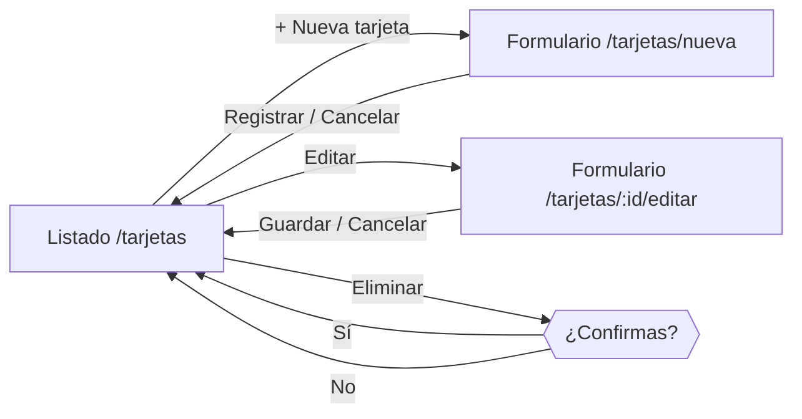

# 01 · El problema: ¿qué vamos a construir?

## 1. Contexto

En Santiago casi todas las personas usan la tarjeta **Bip!** para viajar en Metro y buses.
Muchas familias tienen **varias tarjetas** al mismo tiempo: la del trabajo, la de la universidad
(TNE), la del colegio, la de los abuelos (adulto mayor)…

## 2. Problema

> Una familia maneja entre 3 y 6 tarjetas Bip! y hoy lleva el control en papel o en el celular:
> no sabe **qué tarjeta es de quién**, **cuánto saldo le queda a cada una**, ni **cuáles están bloqueadas**.
> Cuando alguien necesita viajar, hay que revisar tarjeta por tarjeta y a veces se pierden o se duplican registros.

**Necesitamos un sistema web** que permita **registrar, consultar, editar y eliminar** (CRUD) las
tarjetas Bip! de una familia en un solo lugar, validando que los datos sean correctos.

## 3. Alcance

| Dentro del alcance | Fuera del alcance |
|---|---|
| CRUD de tarjetas Bip! | Login / usuarios / roles |
| Validaciones de negocio | Recargas reales ni conexión con la red Bip! |
| Buscar y filtrar tarjetas | Historial de viajes |
| API REST + aplicación web | Aplicación móvil |

> La aplicación es **directa, sin autenticación**: cualquiera que abra la web puede gestionar las tarjetas.
> (En un caso real, el siguiente paso sería agregar login con Spring Security + JWT.)

## 4. Actor

- **Usuario / administrador familiar**: la única persona que usa el sistema.

## 5. Requerimientos funcionales

| Código | Requerimiento |
|---|---|
| RF-01 | El usuario puede **registrar** una tarjeta indicando número, titular, alias (opcional), tipo y saldo inicial. |
| RF-02 | El usuario puede **ver el listado** de todas sus tarjetas con su saldo y estado. |
| RF-03 | El usuario puede **buscar** por número, titular o alias y **filtrar** por estado. |
| RF-04 | El usuario puede **editar** titular, alias, tipo, saldo y estado de una tarjeta. |
| RF-05 | El usuario puede **eliminar** una tarjeta, previa confirmación. |
| RF-06 | El sistema muestra un **resumen**: cantidad de tarjetas, activas y saldo total. |

## 6. Reglas de negocio

| Código | Regla | Dónde se valida |
|---|---|---|
| RN-01 | El **número** de tarjeta tiene entre **8 y 10 dígitos**. | DTO + BD + Angular |
| RN-02 | El número de tarjeta es **único** (no se puede registrar dos veces). | Service + BD (UNIQUE) |
| RN-03 | El **número no se puede modificar** una vez registrada la tarjeta. | Entity (@PrePersist) |
| RN-04 | El **titular** es obligatorio (máx. 100 caracteres). | DTO + BD + Angular |
| RN-05 | El **saldo** va entre **$0 y $100.000**. | DTO + BD + Angular |
| RN-06 | Tipos válidos: `NORMAL`, `TNE_ESCOLAR`, `TNE_SUPERIOR`, `ADULTO_MAYOR`. | Enum + BD |
| RN-07 | Toda tarjeta nueva nace en estado **ACTIVA**; puede pasar a **BLOQUEADA**. | Entity (@PrePersist) |

## 7. Requerimientos no funcionales

- Backend con **Java 21 + Spring Boot** y base de datos **PostgreSQL 18**.
- Frontend con **Angular 21**.
- Arquitectura **MVC en capas** (Controller · Service · Repository · Entity), con patrones de diseño aplicados y documentados.
- Errores con un formato único (JSON) y mensajes claros para el usuario.
- Código probado con tests automáticos.

## 8. Historias de usuario y criterios de aceptación

**HU-01 · Registrar tarjeta**
*Como usuario quiero registrar una tarjeta Bip! para tenerla controlada.*
- Dado que ingreso un número de 8 dígitos, titular y saldo válidos, cuando presiono "Registrar", entonces la tarjeta aparece en el listado como **Activa**.
- Dado que el número ya existe, entonces veo el mensaje *"Ya existe una tarjeta registrada con el número …"*.
- Dado que el saldo es negativo o mayor a $100.000, entonces el formulario me lo impide.

**HU-02 · Ver y buscar tarjetas**
- Al entrar veo todas mis tarjetas, el total, las activas y el saldo acumulado.
- Si escribo en el buscador, la lista se filtra al instante.

**HU-03 · Editar tarjeta**
- El formulario aparece con los datos actuales; el número está bloqueado.
- Al guardar, vuelvo al listado y veo los cambios.

**HU-04 · Eliminar tarjeta**
- Al presionar "Eliminar" se pide confirmación; si confirmo, la tarjeta desaparece.

## 9. API REST resultante

| Método | Ruta | Descripción | Respuesta OK |
|---|---|---|---|
| GET | `/api/tarjetas` | Lista todas las tarjetas | 200 |
| GET | `/api/tarjetas/{id}` | Obtiene una tarjeta | 200 / 404 |
| POST | `/api/tarjetas` | Registra una tarjeta | 201 / 400 / 409 |
| PUT | `/api/tarjetas/{id}` | Edita una tarjeta | 200 / 400 / 404 |
| DELETE | `/api/tarjetas/{id}` | Elimina una tarjeta | 204 / 404 |

## 10. Pantallas

| Pantalla | Ruta Angular | Contenido |
|---|---|---|
| Listado | `/tarjetas` | Resumen, buscador, filtro de estado, tarjetas en formato "card", botones Editar/Eliminar |
| Nueva tarjeta | `/tarjetas/nueva` | Formulario de registro |
| Editar tarjeta | `/tarjetas/:id/editar` | Mismo formulario con datos cargados |

Siguiente: [02 · Teoría de la arquitectura MVC](02-teoria-mvc.md)
