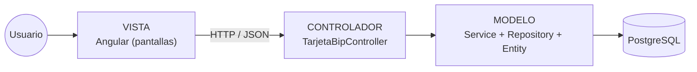
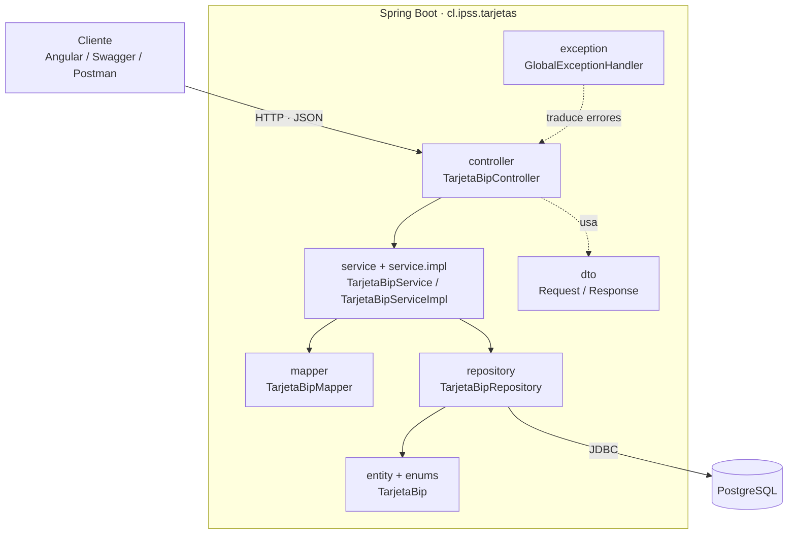
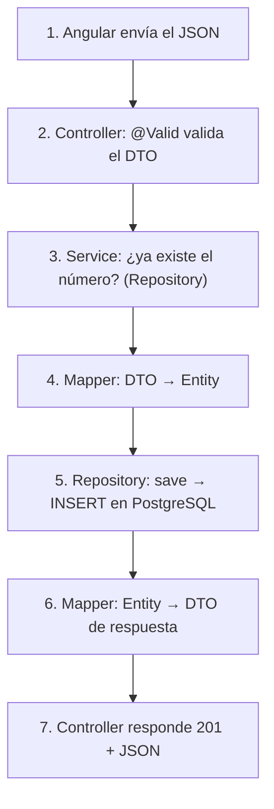
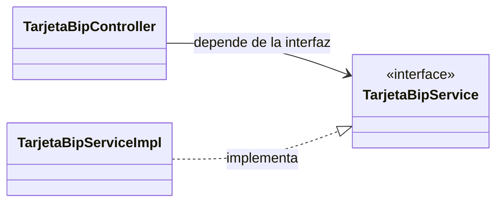
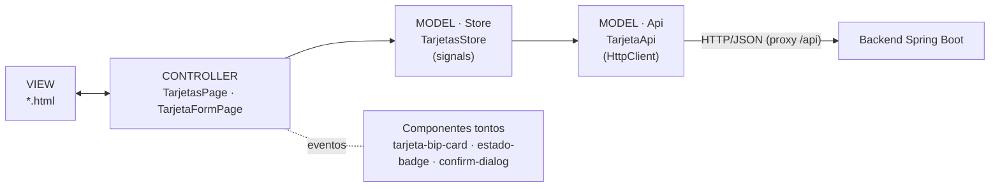

# 02 · Teoría: arquitectura MVC en capas

> Esta es la arquitectura **tradicional** de una aplicación Spring Boot: **Controller → Service → Repository → Entity**.
> (Los diagramas de casos de uso son solo dibujos de análisis; no son una arquitectura. Ver [00 · Casos de uso](00-casos-de-uso.md).)

## 1. ¿Por qué necesitamos separar en capas?

Si escribes **todo en el controller** (recibir JSON, validar, ejecutar SQL, responder) funciona… hasta que:

| Pasa esto | Consecuencia |
|---|---|
| Cambias de base de datos | Reescribes el controller completo |
| Quieres probar una regla (saldo ≤ 100.000) | Necesitas levantar servidor **y** base de datos |
| Dos pantallas usan la misma regla | Copias y pegas código |
| Cambia el formato del JSON | Rompes la lógica de negocio sin querer |

La solución es dividir el código en **capas**: cada una tiene **una responsabilidad** y solo habla con la de abajo.

## 2. MVC: Modelo – Vista – Controlador

| MVC | En el backend (Spring Boot) | En el frontend (Angular) |
|---|---|---|
| **Model** | `entity` + `repository` + `service` (datos y negocio) | `core/models` + `core/api` + `tarjetas.store.ts` |
| **View** | el JSON de respuesta (`TarjetaResponse`) | los `.html` de cada página y componente |
| **Controller** | `TarjetaBipController` | las páginas (`TarjetasPage`, `TarjetaFormPage`) |

## 3. Las capas del backend

| Capa | Paquete | Responsabilidad | NO debe |
|---|---|---|---|
| **Controller** | `controller` | Recibir HTTP, validar con `@Valid`, llamar al service, elegir el código de respuesta | Tener lógica de negocio ni hablar con la BD |
| **Service** | `service` + `service.impl` | Reglas del negocio (¿existe el número? ¿existe la tarjeta?) y transacciones | Conocer HTTP (`ResponseEntity`, códigos de estado) |
| **Repository** | `repository` | Consultar y guardar en la base | Tener reglas de negocio |
| **Entity** | `entity`, `enums` | Representar la tabla (`@Entity`) | Salir hacia el cliente (se devuelve un DTO) |
| **DTO** | `dto` | Definir el JSON de entrada y salida, con validaciones | Contener lógica |
| **Mapper** | `mapper` | Convertir DTO ⇄ Entity | Acceder a la BD |
| **Exception** | `exception` | Errores propios y su traducción a HTTP | — |
| **Config** | `config` | CORS y Swagger | — |

## 4. Viaje de una petición (POST /api/tarjetas)

Cada paso tiene **una sola responsabilidad**: si falla, sabes en qué capa mirar.

## 5. ¿Por qué DTO y Entity son clases distintas?

| Clase | Pertenece a | Lo cambia… |
|---|---|---|
| `CrearTarjetaRequest`, `TarjetaResponse` (DTO) | contrato HTTP | …la forma del JSON que ve Angular |
| `TarjetaBip` (Entity) | base de datos | …la estructura de la tabla |

Si devolvieras la Entity directamente expondrías campos internos y atarías el JSON a la tabla.

## 6. Programar contra interfaces: `Service` + `ServiceImpl`

El controller conoce la **interfaz**; Spring le entrega la implementación (**inyección de dependencias**). Así puedes cambiar la implementación sin tocar el controller y, en los tests, reemplazar el service por un mock.

## 7. Validación en tres niveles (defensa en profundidad)

| Nivel | Herramienta | Qué valida | Respuesta |
|---|---|---|---|
| 1 · DTO | `@NotBlank`, `@Pattern`, `@DecimalMax`… + `@Valid` | Forma de los datos | 400 con detalle por campo |
| 2 · Service | `existsByNumero` | Reglas de negocio | 409 si el número ya existe |
| 3 · Base de datos | `UNIQUE`, `CHECK` | Integridad final | 409 (`DataIntegrityViolationException`) |

## 8. MVC en Angular (carpetas por feature, como `crocante-frontend`)

| Carpeta Angular | Contenido |
|---|---|
| `core/models/` | Interfaces: `Tarjeta`, `TarjetaRequest`, `TarjetaEdicionRequest`, `ApiError` |
| `core/api/` | `TarjetaApi`: las rutas HTTP del backend |
| `core/interceptors/` | `errorInterceptor`: errores del backend → mensajes legibles |
| `shared/ui/` | `Toast` + `ToastService`, `EstadoBadge`, `ConfirmDialog`, pipe `clp` |
| `features/tarjetas/` | `TarjetasStore` (estado), `TarjetasPage` (listado), `TarjetaFormPage` (crear y editar) y `components/tarjeta-bip-card` |
| `proxy.conf.json` | Reenvía `/api` al backend: el navegador usa un solo origen y no hace falta CORS |

**Regla de oro:** los componentes solo reciben datos (`input()`) y emiten eventos (`output()`); solo las **páginas** conocen al **store**, y solo el **store** conoce al **api**.

Anterior: [01 · Problema](01-problema.md) · Siguiente: [03 · Patrones de diseño](03-patrones-de-diseno.md)
