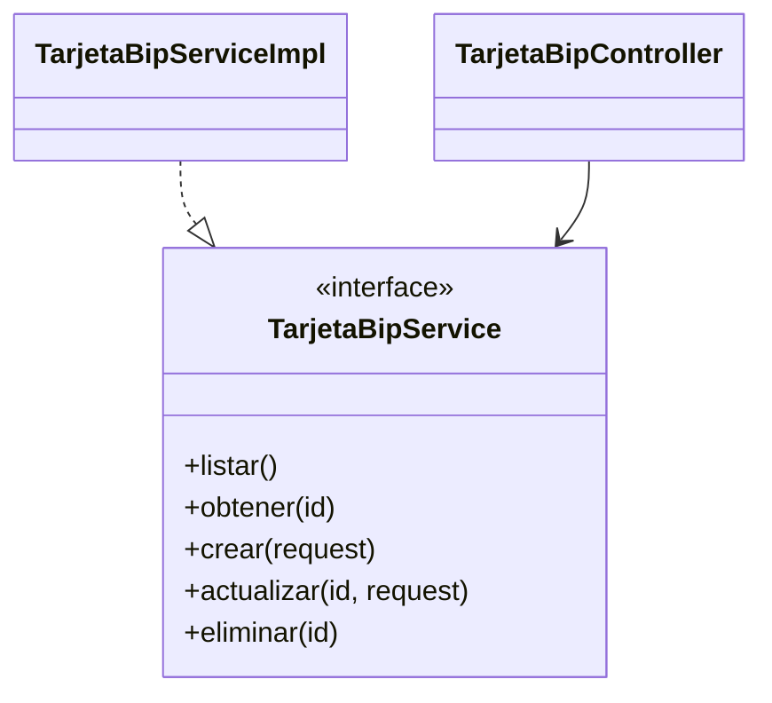
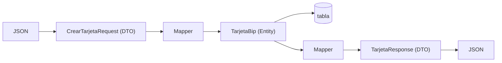
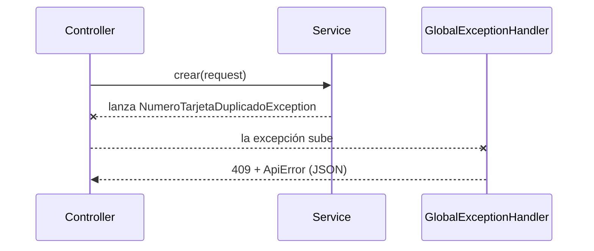

# 03 · Patrones de diseño usados (y por qué)

Un **patrón de diseño** es una solución probada a un problema que se repite. No es código para copiar: es una **idea** para organizar clases.

## Resumen

| # | Patrón | Problema que resuelve | Backend | Frontend |
|---|---|---|---|---|
| 1 | **MVC** | Mezclar pantalla, lógica y datos | `Controller` + `Service` + `Entity` | páginas + store + api + models |
| 2 | **Service Layer** | Lógica de negocio dispersa en los controllers | `TarjetaBipService(Impl)` | `TarjetasStore` |
| 3 | **Repository** | Acceso a datos mezclado con la lógica | `TarjetaBipRepository` (Spring Data) | — |
| 4 | **DTO** | Exponer la Entity al exterior | `*Request`, `TarjetaResponse` | `Tarjeta`, `TarjetaRequest` |
| 5 | **Mapper** | Conversiones repetidas y desordenadas | `TarjetaBipMapper` | — |
| 6 | **Dependency Injection** | Clases atadas a implementaciones concretas | Constructores de Service y Controller | `inject()` |
| 7 | **Singleton** | Una sola instancia compartida | Beans de Spring | `providedIn: 'root'` |
| 8 | **JavaBean (getter/setter)** | Atributos expuestos sin control | `TarjetaBip` con getters y setters | — |
| 9 | **Front Controller** | Un único punto de entrada | `DispatcherServlet` de Spring | `Router` |
| 10 | **Advice / AOP** | Código repetido en todos los controllers | `@RestControllerAdvice`, `@Transactional` | `errorInterceptor` |
| 11 | **Observer** | Que la pantalla se actualice sola | — | `signal` / `computed` |
| 12 | **Facade (Store)** | La pantalla hablando con varias piezas a la vez | — | `TarjetasStore` |
| 13 | **Logging (aspecto transversal)** | Saber qué pasó sin usar el depurador | `Logger` de SLF4J en Service, Controller y Handler | — |

---

## 1. MVC


**Por qué:** si la vista cambia (de Angular a una app móvil), el modelo no se toca.

## 2. Service Layer + programar contra interfaces



**Por qué:** las reglas ("no se repite el número") viven en **un solo lugar**, sin importar quién llame (controller, otro service, un test).

## 3. Repository

```java
public interface TarjetaBipRepository extends JpaRepository<TarjetaBip, Long> {
    boolean existsByNumero(String numero);
}
```

**Por qué:** el service dice *"guarda esta tarjeta"* o *"¿existe este número?"* sin escribir SQL. Spring Data genera la implementación.

## 4. DTO y 5. Mapper



**Por qué:** cada capa habla "su idioma". Un cambio en el JSON no rompe la tabla, y viceversa.

## 6. Inyección de dependencias (DI)

**Sin DI** (malo): `private final repo = new TarjetaBipRepositoryImpl();` → imposible probar sin base de datos.
**Con DI** (bueno): el objeto **recibe** lo que necesita.

```java
public TarjetaBipServiceImpl(TarjetaBipRepository repository, TarjetaBipMapper mapper) { ... }
```

```ts
protected readonly store = inject(TarjetasStore);
```

## 7. Singleton

Spring crea **un solo** `TarjetaBipServiceImpl`; Angular crea **un solo** `TarjetasStore` (`providedIn: 'root'`). Todos comparten la misma instancia.

## 8. JavaBean (getter/setter)

```java
TarjetaBip entidad = new TarjetaBip();
entidad.setNumero("12345678");
entidad.setTitular("Ana");
entidad.setSaldo(BigDecimal.TEN);
```

**Por qué:** los atributos son `private` y se accede a ellos por métodos. Así la clase decide qué se puede leer y qué se puede modificar: `TarjetaBip` no tiene `setId` ni setters de fechas, porque los asigna JPA. Todo escrito a mano, en Java puro.

## 9. Front Controller

Todas las peticiones entran por **un solo servlet** (`DispatcherServlet`) que decide a qué `@RestController` enviarlas según la ruta.

## 10. Advice / AOP



Los controllers **no tienen `try/catch`**: el `@RestControllerAdvice` captura las excepciones de todos en un solo lugar. En Angular, el **interceptor** hace lo mismo con los errores HTTP.

## 11. Observer (signals de Angular)

```ts
protected readonly tarjetasFiltradas = computed(() => /* depende de tarjetas, busqueda y filtroEstado */);
```

Cuando el usuario escribe en el buscador, `busqueda` cambia → `tarjetasFiltradas` se recalcula → el HTML se redibuja. Nadie llama a "actualizar pantalla" manualmente.

## 13. Logging (aspecto transversal)

Registrar lo que ocurre es una preocupación que **atraviesa todas las capas**. Se usa **SLF4J** (interfaz) con **Logback** (implementación), ambos incluidos en Spring Boot; cada clase declara su logger a mano, sin Lombok:

```java
private static final Logger log = LoggerFactory.getLogger(TarjetaBipServiceImpl.class);
log.info("--- command receive to create card: {} ---", numero);
log.warn("--- card number already registered: {} ---", numero);
log.error("Unexpected error processing request", ex);
```

| Capa | Qué registra | Nivel |
|---|---|---|
| Controller | Inicio y fin de cada endpoint (`start/end process endpoint`) | `info` |
| Service | Orden recibida y terminada; reglas rechazadas | `info` / `warn` |
| GlobalExceptionHandler | Datos inválidos y errores inesperados | `warn` / `error` |

Detalle y configuración en la [guía completa](GUIA-COMPLETA-PASO-A-PASO.md) (Pasos 1 y 4).

---

## Principios SOLID aplicados

| Principio | Ejemplo en el proyecto |
|---|---|
| **S** – Responsabilidad única | El controller solo traduce HTTP; el service tiene el negocio; el repository, los datos |
| **O** – Abierto/Cerrado | Agregas un endpoint nuevo sin modificar los existentes |
| **L** – Sustitución de Liskov | Un mock del service reemplaza al real en los tests |
| **I** – Segregación de interfaces | `TarjetaBipService` solo declara operaciones de tarjetas |
| **D** – Inversión de dependencias | El controller depende de la interfaz `TarjetaBipService`, no de la clase concreta |

Anterior: [02 · Teoría MVC](02-teoria-mvc.md) · Siguiente: [04 · UML de clases](04-uml-clases.md)
