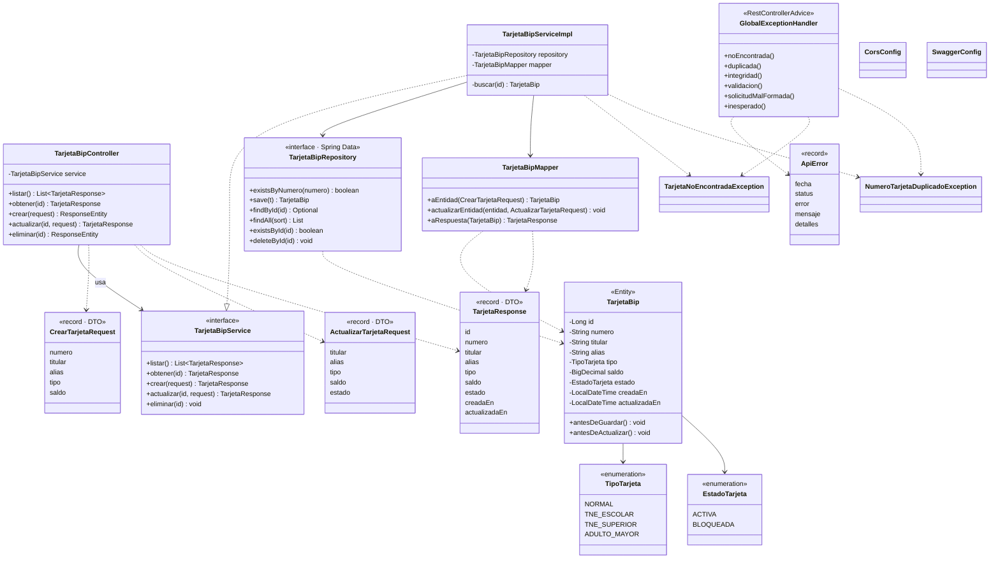
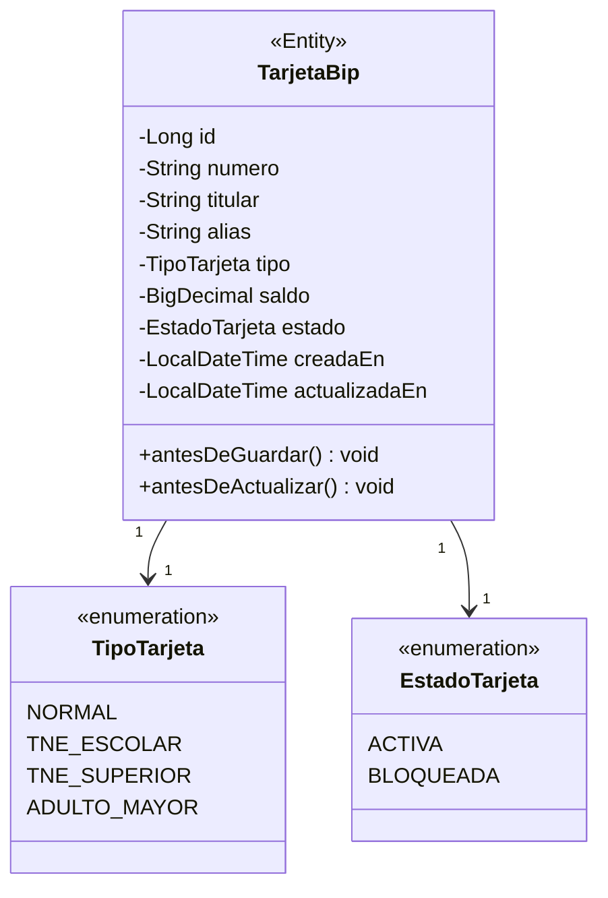
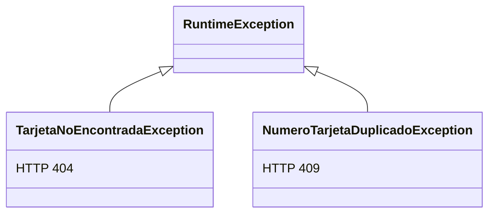
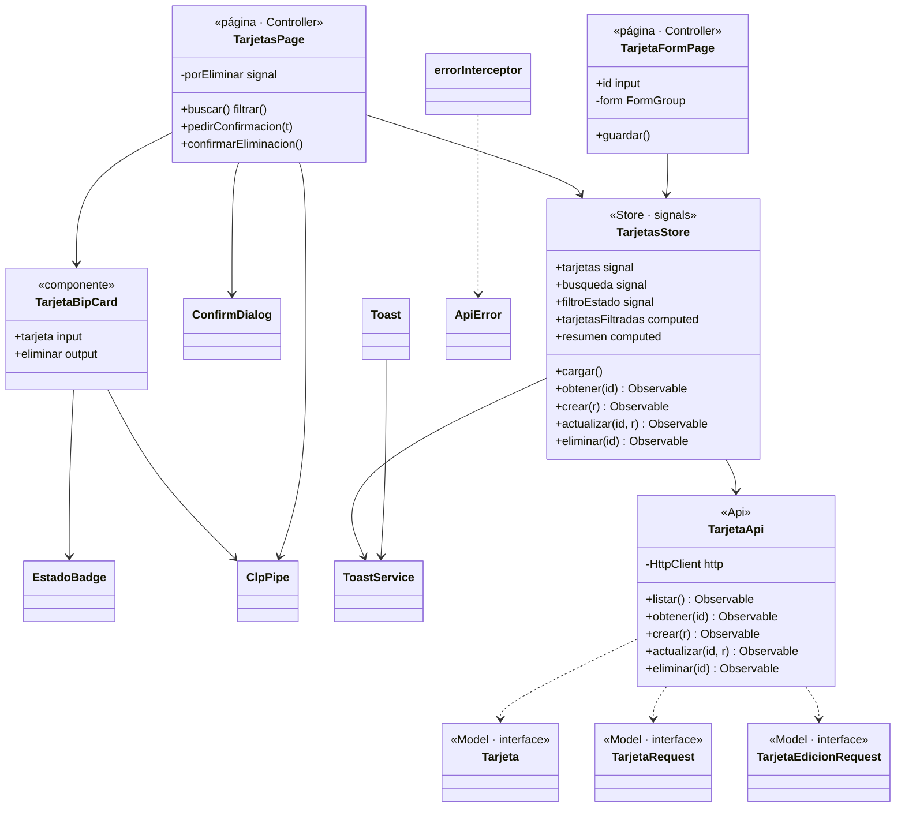
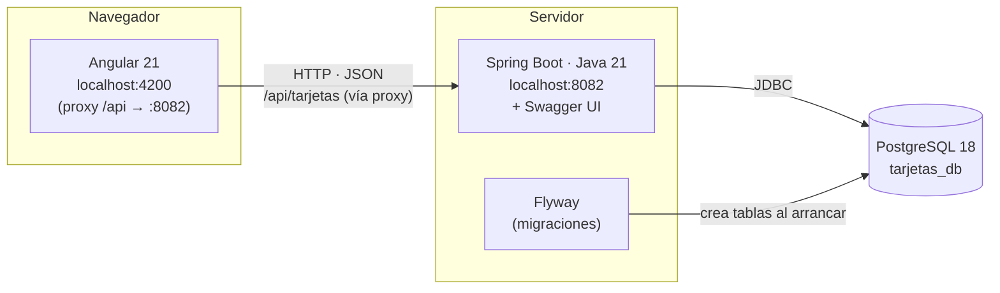

# 04 · Diagramas UML de clases

> Para ver los diagramas en VS Code instala la extensión **"Markdown Preview Mermaid Support"** y abre la vista previa (`Ctrl+Shift+V`). GitHub también los muestra.

## 1. Backend completo (MVC en capas)

### Cómo leerlo

- Línea punteada con triángulo (`..|>`) = **implementa** una interfaz.
- Flecha continua (`-->`) = **tiene / usa** una referencia (inyectada por constructor).
- Flecha punteada (`..>`) = **depende** (la usa en algún método).
- El flujo siempre baja: **Controller → Service → Repository → Entity**. Nunca al revés.

## 2. La Entity y sus enums

## 3. Excepciones y su traducción a HTTP

Además: validaciones de `@Valid` → **400**, JSON mal formado → **400**, violación de integridad en la BD → **409**, cualquier otro error → **500**.

## 4. Frontend Angular (MVC por feature)

## 5. Diagrama de despliegue lógico

Anterior: [03 · Patrones](03-patrones-de-diseno.md) · Siguiente: [05 · UML de secuencia](05-uml-secuencia.md)
