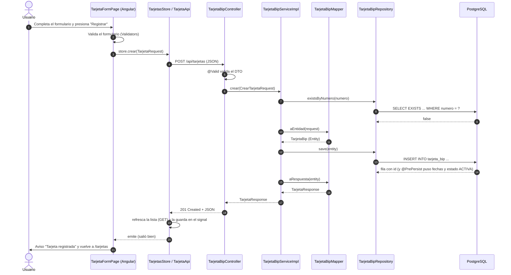
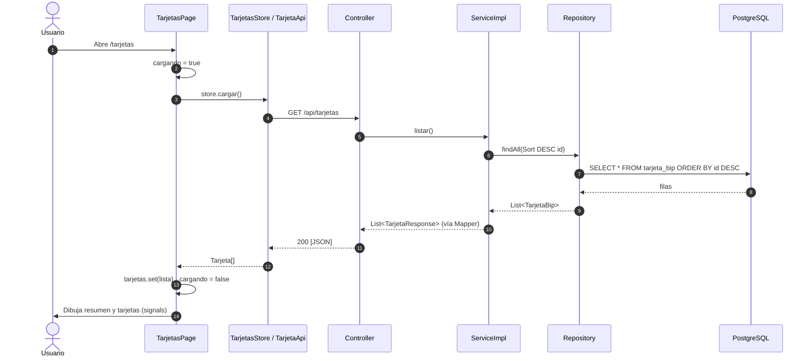
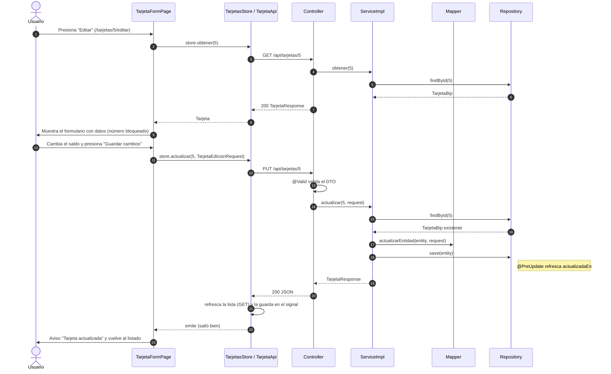
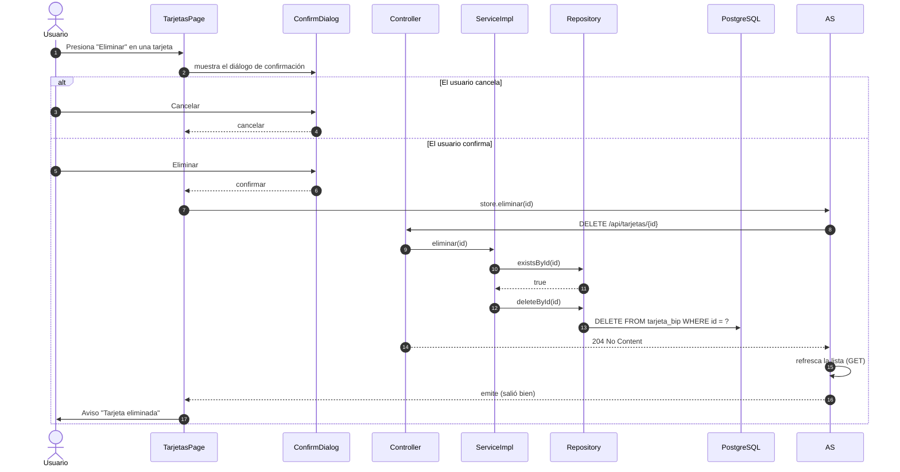
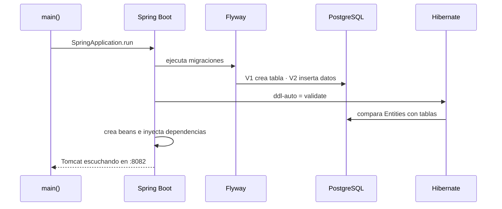

# 05 · Diagramas UML de secuencia

Muestran **quién le habla a quién y en qué orden**. Léelos de arriba hacia abajo.

## 1. Registrar una tarjeta (POST /api/tarjetas) — flujo feliz



## 2. Registrar una tarjeta duplicada (flujo de error 409)

```mermaid
sequenceDiagram
    autonumber
    participant AS as TarjetasStore / TarjetaApi
    participant I as errorInterceptor
    participant C as Controller
    participant S as ServiceImpl
    participant R as Repository
    participant H as GlobalExceptionHandler

    AS->>C: POST /api/tarjetas {numero: "12345678"...}
    C->>S: crear(request)
    S->>R: existsByNumero("12345678")
    R-->>S: true
    S--xC: lanza NumeroTarjetaDuplicadoException
    C--xH: la excepción sube
    H-->>I: 409 {"mensaje": "Ya existe una tarjeta..."}
    I-->>AS: AppError("Ya existe una tarjeta...")
    Note over AS: Aviso rojo con el mensaje; el formulario sigue abierto
```

## 3. Listar tarjetas (GET /api/tarjetas)



## 4. Editar una tarjeta (GET + PUT)



## 5. Eliminar una tarjeta (DELETE)



## 6. Arranque del backend



Anterior: [04 · UML de clases](04-uml-clases.md) · Siguiente: [06 · Modelo de base de datos](06-modelo-base-de-datos.md)
