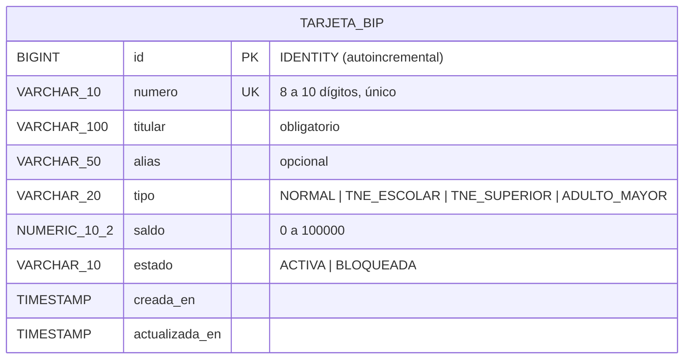
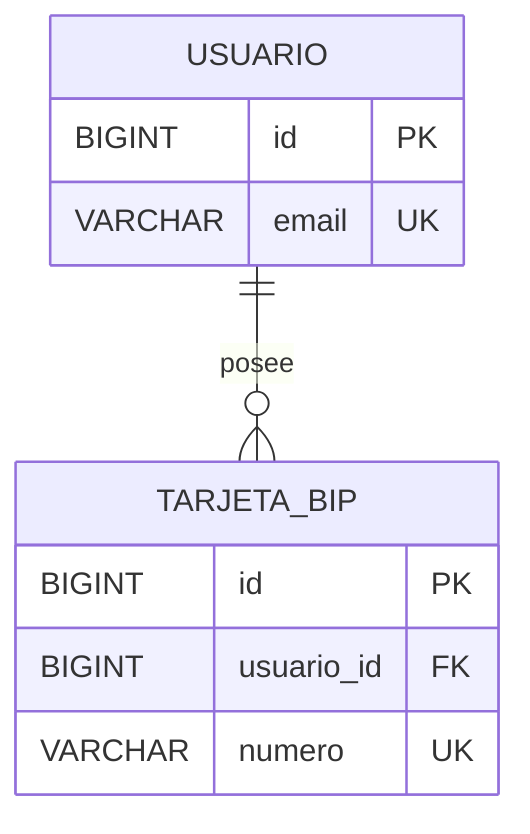

# 06 · Modelo de base de datos (PostgreSQL 18)

## 1. Diagrama entidad-relación

Por ser una aplicación sin login, hay **una sola tabla**. Los tipos y estados son listas cerradas
controladas con `CHECK` (no necesitan tablas aparte para este alcance).



> **Evolución futura** (si agregas login): una tabla `usuario` y una relación
> `USUARIO ||--o{ TARJETA_BIP : posee`.



## 2. Script SQL (migración `V1__crear_tabla_tarjeta_bip.sql`)

```sql
CREATE TABLE tarjeta_bip (
    id             BIGINT GENERATED ALWAYS AS IDENTITY PRIMARY KEY,
    numero         VARCHAR(10)   NOT NULL,
    titular        VARCHAR(100)  NOT NULL,
    alias          VARCHAR(50),
    tipo           VARCHAR(20)   NOT NULL,
    saldo          NUMERIC(10,2) NOT NULL DEFAULT 0,
    estado         VARCHAR(10)   NOT NULL DEFAULT 'ACTIVA',
    creada_en      TIMESTAMP     NOT NULL DEFAULT CURRENT_TIMESTAMP,
    actualizada_en TIMESTAMP     NOT NULL DEFAULT CURRENT_TIMESTAMP,

    CONSTRAINT uq_tarjeta_bip_numero UNIQUE (numero),
    CONSTRAINT ck_tarjeta_bip_numero CHECK (numero ~ '^[0-9]{8,10}$'),
    CONSTRAINT ck_tarjeta_bip_tipo   CHECK (tipo IN ('NORMAL','TNE_ESCOLAR','TNE_SUPERIOR','ADULTO_MAYOR')),
    CONSTRAINT ck_tarjeta_bip_estado CHECK (estado IN ('ACTIVA','BLOQUEADA')),
    CONSTRAINT ck_tarjeta_bip_saldo  CHECK (saldo >= 0 AND saldo <= 100000)
);
CREATE INDEX idx_tarjeta_bip_titular ON tarjeta_bip (titular);
```

## 3. Diccionario de datos

| Columna | Tipo | Nulo | Restricción | Para qué sirve |
|---|---|---|---|---|
| `id` | BIGINT identity | No | PK | Identificador técnico, lo genera PostgreSQL |
| `numero` | VARCHAR(10) | No | UNIQUE + CHECK regex | Número impreso en la tarjeta (identidad de negocio) |
| `titular` | VARCHAR(100) | No | — | Persona que usa la tarjeta |
| `alias` | VARCHAR(50) | Sí | — | Apodo para reconocerla |
| `tipo` | VARCHAR(20) | No | CHECK lista | Tipo de tarjeta |
| `saldo` | NUMERIC(10,2) | No | CHECK 0..100000 | Saldo en pesos (no usamos `float` con dinero) |
| `estado` | VARCHAR(10) | No | CHECK lista | ACTIVA / BLOQUEADA |
| `creada_en` | TIMESTAMP | No | default now | Auditoría |
| `actualizada_en` | TIMESTAMP | No | default now | Auditoría |

## 4. Decisiones de diseño (para defender en clase)

| Decisión | Razón |
|---|---|
| `NUMERIC(10,2)` y `BigDecimal` para el saldo | Los `float/double` generan errores de redondeo con dinero |
| `UNIQUE (numero)` aunque el servicio ya lo valide | Defensa en profundidad: dos peticiones simultáneas no pueden duplicar |
| `CHECK` en la base **y** validaciones en el DTO | La BD es la última barrera; el DTO da mensajes claros |
| `GENERATED ALWAYS AS IDENTITY` | Forma moderna y estándar de autoincremental (en lugar de `SERIAL`) |
| Enums como `VARCHAR` + `CHECK` | Fácil de leer en la tabla y de cambiar con una migración |
| Flyway en vez de `ddl-auto=update` | El esquema queda **versionado** (como el código) y repetible |
| `ddl-auto=validate` | Hibernate solo comprueba que las Entities coincidan con las tablas |

## 5. Correspondencia Entity ↔ tabla

| Atributo de `TarjetaBip` (Entity) | Anotación JPA | Columna |
|---|---|---|
| `id` | `@Id @GeneratedValue(IDENTITY)` | `id` |
| `numero` | `@Column(unique = true, length = 10)` | `numero` |
| `titular` | `@Column(nullable = false, length = 100)` | `titular` |
| `alias` | `@Column(length = 50)` | `alias` |
| `tipo` | `@Enumerated(EnumType.STRING)` | `tipo` |
| `saldo` | `@Column(precision = 10, scale = 2)` | `saldo` |
| `estado` | `@Enumerated(EnumType.STRING)` | `estado` |
| `creadaEn` | `@Column(name = "creada_en", updatable = false)` | `creada_en` |
| `actualizadaEn` | `@Column(name = "actualizada_en")` | `actualizada_en` |

## 6. Crear la base de datos

Conéctate con el usuario `postgres` (tu clave es la que definiste al instalar PostgreSQL 18):

```bash
psql -U postgres -h localhost -p 5432 -c "CREATE DATABASE tarjetas_db;"
```

> **¿Qué puerto usa tu PostgreSQL 18?** Si tienes dos versiones instaladas (por ejemplo la 14 y la 18),
> una usa el `5432` y la otra el `5433`. Para saber el puerto de la que te conectaste:
> `psql -U postgres -h localhost -p 5433 -c "SHOW port;"`

Flyway creará la tabla y los datos de ejemplo la primera vez que arranque el backend.

### ¿Con qué usuario se conecta el backend?

Crear la base de datos (con `psql` o con **pgAdmin**: clic derecho en *Databases → Create → Database…* → nombre `tarjetas_db`) **no define el usuario**: el usuario es **el de la conexión con la que entras a PostgreSQL**. El backend lee estas variables (valores por defecto entre paréntesis):

| Variable | Qué es | Por defecto |
|---|---|---|
| `DB_USER` | Usuario de PostgreSQL | `tarjetas` |
| `DB_PASSWORD` | Su clave | `tarjetas` |
| `DB_PORT` | Puerto del servidor | `5432` |
| `DB_NAME` | Nombre de la base | `tarjetas_db` |

**Opción A · Usar el mismo usuario con el que entras a pgAdmin.** Casi siempre es `postgres` con la clave que definiste al instalar PostgreSQL 18. Como el proyecto trae por defecto el usuario `tarjetas`, aquí **sí** debes indicar el usuario y la clave antes de levantar el backend (y el puerto si no es el 5432):

```powershell
$env:DB_USER = "postgres"
$env:DB_PASSWORD = "la_clave_de_postgres"
# $env:DB_PORT = "5433"     # solo si tu PostgreSQL 18 no usa el 5432
```

> ¿Cuál es mi puerto? En pgAdmin: clic derecho sobre el servidor → *Properties → Connection → Port*. O en el *Query Tool*: `SHOW port;`

**Opción B · Crear un usuario propio para esta aplicación (es la que usa el proyecto por defecto: usuario `tarjetas`, clave `tarjetas`).** Es lo habitual: un usuario por aplicación. En pgAdmin abre el **Query Tool sobre la base `tarjetas_db`** (clic derecho en `tarjetas_db` → *Query Tool*), pega este script y ejecútalo con **F5**:

```sql
-- Crea el usuario (o le actualiza la clave si ya existe)
DO $
BEGIN
    IF NOT EXISTS (SELECT FROM pg_roles WHERE rolname = 'tarjetas') THEN
        CREATE USER tarjetas WITH PASSWORD 'tarjetas';
    ELSE
        ALTER USER tarjetas WITH PASSWORD 'tarjetas';
    END IF;
END
$;

-- Lo hace dueño de la base: así Flyway puede crear la tabla y los datos
ALTER DATABASE tarjetas_db OWNER TO tarjetas;
GRANT ALL PRIVILEGES ON DATABASE tarjetas_db TO tarjetas;
GRANT ALL ON SCHEMA public TO tarjetas;
```

Luego levanta el backend con ese usuario:

```powershell
$env:DB_USER = "tarjetas"
$env:DB_PASSWORD = "tarjetas"
.\mvnw.cmd spring-boot:run
```

**¿Por qué hace falta `GRANT ALL ON SCHEMA public`?** Desde PostgreSQL 15 los usuarios normales ya no pueden crear tablas en el esquema `public` por defecto. Como el dueño de la base ya puede, el `GRANT` es una segunda garantía. Sin ellos Flyway fallaría con *permission denied for schema public*.

**¿Cómo saber si el usuario y la clave están bien?** Antes de levantar el backend prueba la conexión:

```powershell
psql -U tarjetas -h localhost -p 5432 -d tarjetas_db -c "SELECT current_user;"
```

Si pide clave y responde `tarjetas`, el backend podrá conectarse igual. Si dice *password authentication failed*, el usuario o la clave no coinciden.

### Cómo decirle al backend qué usuario y clave usar (3 formas)

El backend lee su conexión del archivo `src/main/resources/application.yml`. Estas son las líneas importantes:

```yaml
spring:
  datasource:
    url: jdbc:postgresql://${DB_HOST:localhost}:${DB_PORT:5432}/${DB_NAME:tarjetas_db}
    username: ${DB_USER:tarjetas}
    password: ${DB_PASSWORD:tarjetas}
```

**Cómo leer `${DB_USER:tarjetas}`:** significa *"usa la variable de entorno `DB_USER`; si no existe, usa `tarjetas`"*. Lo que está **después de los dos puntos** es el valor por defecto. Por eso hay tres formas de cambiarlo; elige **una**:

| Forma | Qué haces | Cuándo conviene |
|---|---|---|
| **1. Editar el `application.yml`** | Cambias el valor por defecto (lo que va después de `:`) | Lo más simple en clases: lo cambias una vez y listo |
| **2. Variables de entorno en la terminal** | `$env:DB_USER = "..."` antes de `mvnw spring-boot:run` | Si ejecutas el backend desde la terminal; hay que repetirlo en cada terminal nueva |
| **3. Variables en tu IDE** | Las defines en la configuración de ejecución | Si ejecutas desde Eclipse/STS, IntelliJ o VS Code |

#### Forma 1 · Editar el `application.yml`

Abre `src/main/resources/application.yml` y cambia **solo lo que va después de los dos puntos**:

| Situación | `username` | `password` | `url` (puerto) |
|---|---|---|---|
| Usuario propio creado con el script (Opción B) — **ya viene así** | `${DB_USER:tarjetas}` | `${DB_PASSWORD:tarjetas}` | sin cambios |
| Usuario `postgres` con tu clave (Opción A) | `${DB_USER:postgres}` | `${DB_PASSWORD:tu_clave}` | sin cambios |
| Tu PostgreSQL 18 usa el puerto 5433 | (el de arriba) | (el de arriba) | `${DB_PORT:5433}` |

Ejemplo final para el **usuario propio** (Opción B, el valor por defecto del proyecto):

```yaml
    url: jdbc:postgresql://${DB_HOST:localhost}:${DB_PORT:5432}/${DB_NAME:tarjetas_db}
    username: ${DB_USER:tarjetas}
    password: ${DB_PASSWORD:tarjetas}
```

> Respeta los dos puntos y las llaves: `${NOMBRE:valor}`. **No** dejes espacios alrededor de los dos puntos y **no** borres el `${ }`. Guarda el archivo (**Ctrl+S**) y **reinicia** la aplicación: Spring solo lee el archivo al arrancar.
>
> ⚠️ Una clave escrita en el archivo es válida para **clases**. Si algún día subes el proyecto a un repositorio, deja el valor por defecto genérico y usa las formas 2 o 3.

#### Forma 2 · Variables de entorno en la terminal (PowerShell)

```powershell
$env:DB_USER = "tarjetas"
$env:DB_PASSWORD = "tarjetas"
# $env:DB_PORT = "5433"      # solo si tu puerto no es el 5432
.\mvnw.cmd spring-boot:run
```

Las variables valen **solo para esa terminal**: si la cierras o abres otra, hay que definirlas de nuevo.

#### Forma 3 · Variables en el IDE

| IDE | Dónde |
|---|---|
| **Eclipse / STS** | *Run → Run Configurations…* → selecciona tu aplicación Spring Boot → pestaña **Environment** → **Add…** → Name `DB_USER`, Value `tarjetas`; repite con `DB_PASSWORD` → **Apply** → **Run** |
| **IntelliJ IDEA** | *Run → Edit Configurations…* → tu aplicación → campo **Environment variables** → `DB_USER=tarjetas;DB_PASSWORD=tarjetas` |
| **VS Code** | En `.vscode/launch.json`, dentro de la configuración de Java: `"env": { "DB_USER": "tarjetas", "DB_PASSWORD": "tarjetas" }` |

#### ✅ ¿Cómo sé que quedó bien?

1. **Primero prueba el usuario fuera del backend** (así descartas la clave como causa):

   ```powershell
   psql -U tarjetas -h localhost -p 5432 -d tarjetas_db -c "SELECT current_user;"
   ```

   Debe responder `tarjetas`.

2. **Levanta el backend.** En la consola debe aparecer:

   ```
   HikariPool-1 - Start completed.
   Database: jdbc:postgresql://localhost:5432/tarjetas_db (PostgreSQL 18.x)
   Successfully applied 2 migrations to schema "public"
   Started TarjetasApplication in ... seconds
   ```

3. **Comprueba en pgAdmin** (refrescando `tarjetas_db → Schemas → public → Tables`): aparecen `tarjeta_bip` y `flyway_schema_history`.

#### 🔧 Errores de conexión más comunes

| Mensaje en la consola | Qué significa | Solución |
|---|---|---|
| `FATAL: password authentication failed for user "tarjetas"` | La clave (o el usuario) no coincide | Revisa `DB_PASSWORD`/`DB_USER`. Para reponer la clave en pgAdmin: `ALTER USER tarjetas WITH PASSWORD 'tarjetas';` |
| `FATAL: role "tarjetas" does not exist` | El usuario por defecto del proyecto aún no existe en tu PostgreSQL | Ejecuta el script de la **Opción B** (o usa `postgres` con la Opción A) |
| `FATAL: database "tarjetas_db" does not exist` | No creaste la base, o está mal escrito `DB_NAME` | Crea `tarjetas_db` (Paso 0, punto 2) |
| `Connection refused` / `Connection to localhost:5432 refused` | Puerto equivocado o PostgreSQL apagado | Verifica el puerto con `SHOW port;` y cámbialo (`DB_PORT`); revisa que el servicio esté en ejecución |
| `permission denied for schema public` (Flyway) | El usuario no puede crear tablas | Ejecuta `ALTER DATABASE tarjetas_db OWNER TO tarjetas;` y `GRANT ALL ON SCHEMA public TO tarjetas;` conectado a `tarjetas_db` |
| Cambié el `application.yml` y sigue igual | La aplicación no se reinició, o se compiló una copia vieja | Detén y vuelve a ejecutar; en Eclipse: *Project → Clean…* |
| Probé en otra terminal y vuelve a fallar | Las variables `$env:` valen solo para la terminal donde se definieron | Defínelas de nuevo, o usa la Forma 1 o la Forma 3 |


## 7. Consultas útiles para comprobar

```sql
SELECT * FROM tarjeta_bip ORDER BY id;
SELECT estado, COUNT(*), SUM(saldo) FROM tarjeta_bip GROUP BY estado;
SELECT * FROM flyway_schema_history;   -- historial de migraciones aplicadas
```

Anterior: [05 · UML de secuencia](05-uml-secuencia.md) · Siguiente: [Guía completa paso a paso](GUIA-COMPLETA-PASO-A-PASO.md)
