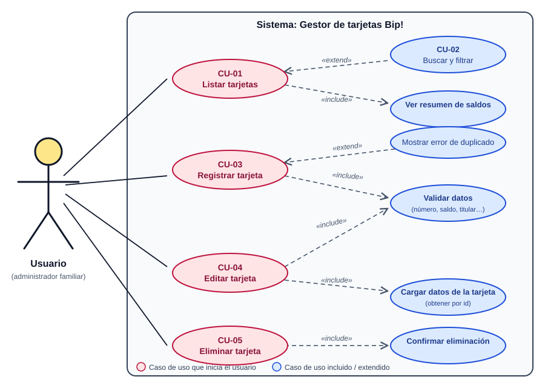
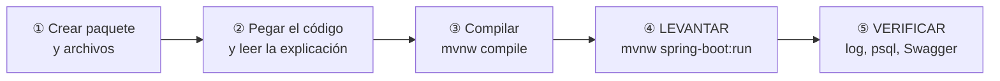
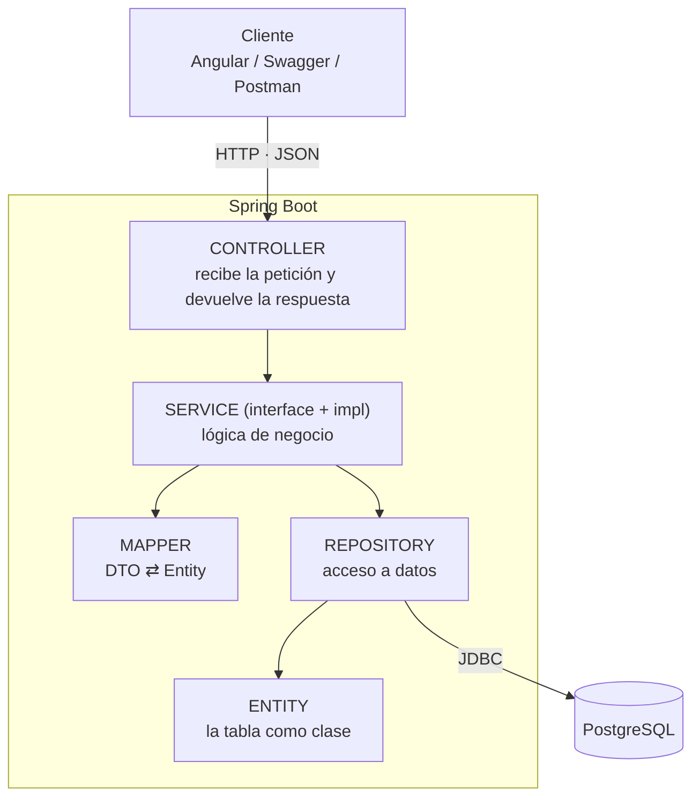
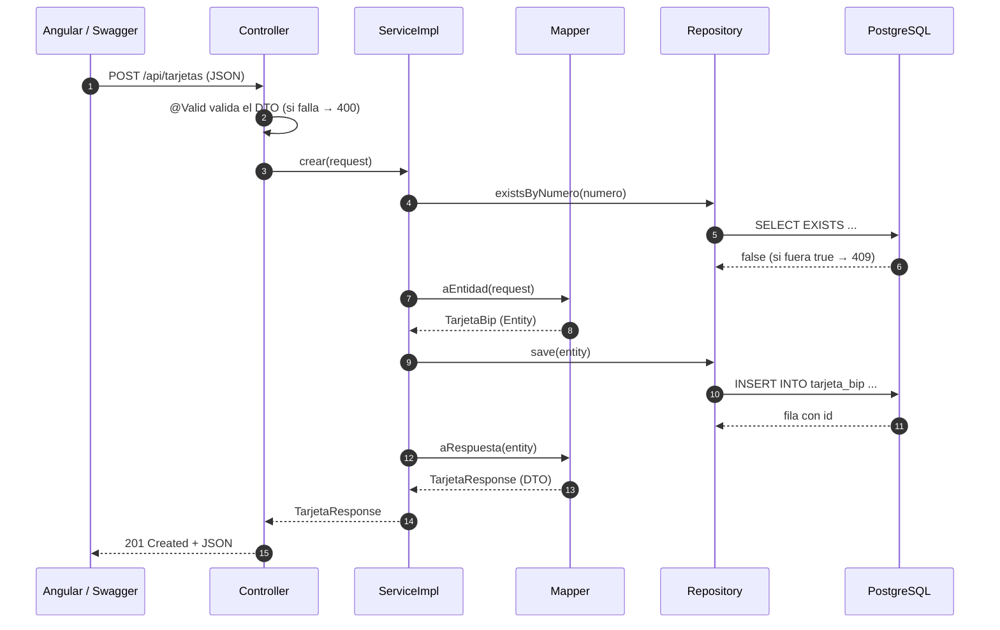
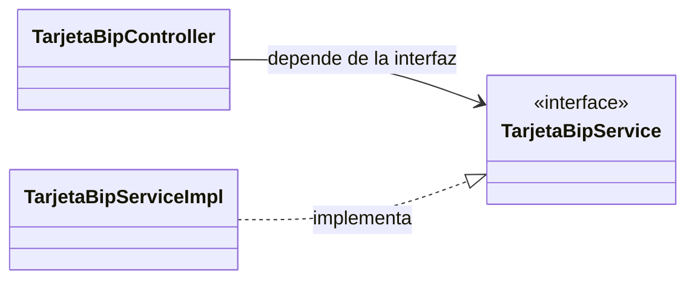
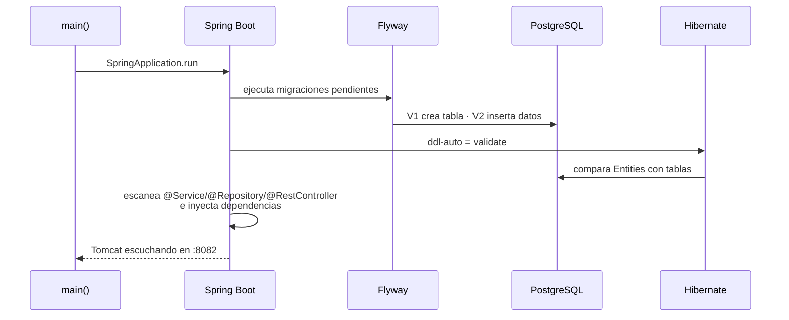
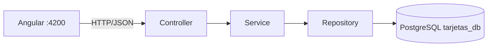

# Guía completa paso a paso: Backend de Tarjetas Bip!

**Java 21 · Spring Boot 3.5 · PostgreSQL 18 · Arquitectura MVC en capas (Controller · Service · Repository · Entity)**
Al terminar tendrás la API corriendo en `http://localhost:8082`, documentada en Swagger y lista para que la use el Angular (que ya está hecho).

> **Cómo usar esta guía.** Trabajas en **`tarjetas-backend-base`** (proyecto en blanco). El proyecto terminado y funcional, para comparar, es **`tarjetas-backend`**.
> Cada paso sigue el mismo ritmo: **crear → compilar → LEVANTAR → VERIFICAR**. No pases al siguiente paso hasta que la verificación salga bien.

## Mapa del proceso

```
Fase de análisis  Diagrama de casos de uso (qué debe hacer el sistema)
Paso 0  Preparar el entorno y la base de datos
Paso 1  Levantar el proyecto base y verificar la conexión (Flyway, Swagger vacío)
Paso 2  Crear el MODELO: enums + entity + repository       → levantar y verificar (Hibernate valida)
Paso 3  Crear DTOs + excepciones + manejo de errores        → levantar y verificar
Paso 4  Crear Mapper + Service (interface + impl)            → levantar y verificar (beans)
Paso 5  Crear la configuración: Swagger y CORS               → levantar y ver Swagger UI
Paso 6  Crear el CONTROLLER                                  → levantar y PROBAR TODO en Swagger
Paso 7  Tests automáticos                                    → mvnw test
Paso 8  Conectar con Angular
Anexo   Problemas frecuentes · checklist · resumen
```

Estructura final de paquetes (cada paso te dice cuándo crear cada uno):

```
cl.ipss.tarjetas
├── enums          Paso 2
├── entity         Paso 2   (Model)
├── repository     Paso 2
├── dto            Paso 3
├── exception      Paso 3
├── mapper         Paso 4
├── service        Paso 4   (interface)
│   └── impl       Paso 4   (implementación)
├── config         Paso 5
└── controller     Paso 6   (Controller)
```


---

## Fase de análisis: diagrama de casos de uso (antes de construir)

Antes de escribir una sola línea de código se responde: **¿qué necesita poder hacer el usuario?** Eso se dibuja en un **diagrama UML de casos de uso**.



*(Versión completa con teoría, especificaciones y código PlantUML: [00-casos-de-uso.md](00-casos-de-uso.md).)*

### Cómo leerlo

| Elemento | Se dibuja como | Significa |
|---|---|---|
| **Actor** | El **monito** | Quien usa el sistema desde afuera (aquí, el Usuario; no hay login) |
| **Caso de uso** | Un **óvalo** (las "esferas") | Un **objetivo** del usuario, con verbo: *Registrar tarjeta* |
| **Límite del sistema** | El rectángulo grande | Lo que construimos nosotros |
| **Asociación** | Línea continua | El actor participa en ese caso de uso |
| **«include»** | Flecha punteada | El caso **siempre** necesita al otro (*Registrar* → *Validar datos*) |
| **«extend»** | Flecha punteada | El otro se agrega **a veces** (*Registrar* ← *Mostrar error de duplicado*) |

> **¿Cada óvalo es un método?** No exactamente: un óvalo es un **objetivo del usuario**. En un CRUD simple, un óvalo principal termina siendo **un endpoint → un método del Controller → un método del Service**, pero hay óvalos que no son método (*Validar datos* son anotaciones; *Buscar y filtrar* lo hace Angular).

### De los óvalos al código

| Caso de uso | Endpoint | Método del Service | Repository | Se construye en |
|---|---|---|---|---|
| CU-01 Listar tarjetas | `GET /api/tarjetas` | `listar()` | `findAll` | Paso 6 |
| Cargar datos de la tarjeta | `GET /api/tarjetas/{id}` | `obtener()` | `findById` | Paso 6 |
| CU-03 Registrar tarjeta | `POST /api/tarjetas` | `crear()` | `existsByNumero` + `save` | Paso 6 |
| CU-04 Editar tarjeta | `PUT /api/tarjetas/{id}` | `actualizar()` | `findById` + `save` | Paso 6 |
| CU-05 Eliminar tarjeta | `DELETE /api/tarjetas/{id}` | `eliminar()` | `existsById` + `deleteById` | Paso 6 |
| Validar datos | (anotaciones del DTO + `@Valid`) | — | — | Paso 3 y 6 |
| Mostrar error de duplicado | respuesta `409` | lanza `NumeroTarjetaDuplicadoException` | — | Paso 3 y 4 |
| CU-02 Buscar y filtrar, Ver resumen, Confirmar eliminación | *(solo Angular)* | — | — | Frontend |

Por eso esta guía construye **primero la base común** (Pasos 2 a 5) y recién en el **Paso 6** aparecen, de golpe, todos los casos de uso que podrás **probar uno por uno en Swagger**.


---

## Teoría previa (léela antes de empezar)

### 0. Vocabulario Java que usarás en cada paso

| Concepto | Qué es | Ejemplo en el proyecto |
|---|---|---|
| **Package (paquete)** | Una carpeta con nombre calificado que agrupa clases relacionadas. `cl.ipss.tarjetas.entity` equivale a la ruta `cl/ipss/tarjetas/entity/`. La **primera línea** de cada archivo declara a qué paquete pertenece | `package cl.ipss.tarjetas.entity;` |
| **class** | Molde con datos y métodos | `TarjetaBip`, `TarjetaBipServiceImpl` |
| **interface** | Contrato de métodos sin código | `TarjetaBipService`, `TarjetaBipRepository` |
| **enum** | Lista cerrada de valores | `TipoTarjeta`, `EstadoTarjeta` |
| **record** | Clase inmutable de solo datos | los DTO |
| **Anotación (`@Algo`)** | Una etiqueta que le da instrucciones al framework | `@Service`, `@RestController`, `@Entity` |
| **Bean** | Objeto creado y administrado por Spring | todo lo que lleve `@Service`, `@Repository`, `@RestController`, `@Component`, `@Configuration` |

**El ritual de cada paso de esta guía:**



Así **nunca avanzas con un error escondido**: cada paso termina con el proyecto funcionando.

### 1. ¿Qué es la arquitectura MVC en capas?

Es la arquitectura "tradicional" de las aplicaciones Spring Boot: cada capa tiene **una responsabilidad** y solo habla con la capa de abajo.



| Capa | Paquete | Responsabilidad | NO debe |
|---|---|---|---|
| **Controller** | `controller` | Recibir HTTP, validar (`@Valid`), llamar al service, elegir el código de respuesta | Tener lógica de negocio ni hablar con la BD |
| **Service** | `service` + `service.impl` | Reglas del negocio (¿existe el número?, ¿existe la tarjeta?), transacciones | Conocer HTTP (`ResponseEntity`, códigos de estado) |
| **Repository** | `repository` | Consultar y guardar en la BD | Tener reglas de negocio |
| **Entity** | `entity` | Representar una tabla (`@Entity`) | Salir hacia el cliente (se devuelve un DTO) |
| **DTO** | `dto` | Definir el JSON de entrada y salida | Contener lógica |
| **Mapper** | `mapper` | Convertir DTO ⇄ Entity | Acceder a la BD |
| **Exception** | `exception` | Errores propios y su traducción a HTTP | — |
| **Config** | `config` | CORS, Swagger | — |

### 2. MVC: Modelo – Vista – Controlador

| MVC | En nuestro backend | En el frontend |
|---|---|---|
| **Model** | `entity` + `repository` + `service` (los datos y el negocio) | `core/models` + `core/api` + `TarjetasStore` |
| **View** | el JSON de respuesta (`TarjetaResponse`) | los `.html` de Angular |
| **Controller** | `TarjetaBipController` | las páginas (`TarjetasPage`, `TarjetaFormPage`) |

### 3. Viaje de una petición (POST /api/tarjetas)



### 4. ¿Por qué DTO y Entity son clases distintas?

| Clase | Pertenece a | Lo cambia… |
|---|---|---|
| `CrearTarjetaRequest`, `TarjetaResponse` (DTO) | contrato HTTP | …la forma del JSON que ve Angular |
| `TarjetaBip` (Entity) | base de datos | …la estructura de la tabla |

Si devolvieras la Entity directamente expondrías campos internos y atarías el JSON a la tabla. Con DTO cada uno cambia por su lado.

### 5. Programar contra interfaces (Service + ServiceImpl)



El controller conoce solo la **interfaz**. Spring le entrega la implementación (**inyección de dependencias**). Ventajas: puedes cambiar la implementación sin tocar el controller y, en los tests, reemplazar el service por uno simulado (mock).

### 6. Patrones de diseño que usarás

| Patrón | Problema que resuelve | Dónde lo verás |
|---|---|---|
| **MVC** | Mezclar pantalla, lógica y datos | Controller / Service / Entity |
| **Service Layer** | La lógica de negocio dispersa en controllers | `TarjetaBipService` |
| **Repository** | Acceso a datos mezclado con la lógica | `TarjetaBipRepository` |
| **DTO** | Exponer la Entity al exterior | `*Request`, `TarjetaResponse` |
| **Mapper** | Conversiones repetidas y desordenadas | `TarjetaBipMapper` |
| **Dependency Injection** | Clases atadas a implementaciones concretas | constructores del Service y Controller |
| **Singleton** | Una sola instancia compartida | Beans de Spring (`@Service`, `@Component`…) |
| **Builder** | Constructores con muchos parámetros | `TarjetaBip.builder()` (Lombok) |
| **Front Controller** | Un solo punto de entrada | `DispatcherServlet` de Spring |
| **Advice / AOP** | Código repetido en todos los controllers | `@RestControllerAdvice`, `@Transactional` |

### 7. Principios SOLID

| Principio | Ejemplo |
|---|---|
| **S** – Responsabilidad única | El controller solo traduce HTTP; el service tiene el negocio |
| **O** – Abierto/Cerrado | Agregas un endpoint nuevo sin modificar los existentes |
| **L** – Sustitución de Liskov | Un mock del service reemplaza al real en los tests |
| **I** – Segregación de interfaces | `TarjetaBipService` solo declara operaciones de tarjetas |
| **D** – Inversión de dependencias | Controller → interfaz `TarjetaBipService` ← `TarjetaBipServiceImpl` |


---

## Paso 0 · Preparar el entorno y la base de datos

**🎓 Teoría — ¿por qué empezar por la base de datos y las herramientas?**
Una aplicación web de tres capas necesita tres cosas funcionando: el **cliente** (Angular o Swagger), el **servidor** (Spring Boot) y la **base de datos** (PostgreSQL). Si falla la base, todo lo demás falla con mensajes confusos; por eso se verifica primero.
**JDK 21**: Spring Boot 3.5 exige Java 17+, y usamos 21 (LTS) para aprovechar `record` y mejor rendimiento. **Maven Wrapper (`mvnw`)**: un script que descarga la versión correcta de Maven, así todos compilan igual sin instalar nada. **Lombok**: en IntelliJ instala/activa el plugin *Lombok* y marca *Enable annotation processing*; en VS Code basta con la extensión *Language Support for Java*.

**Necesitas:** JDK 21, PostgreSQL 18, un IDE (IntelliJ IDEA o VS Code + *Extension Pack for Java*), Node 22+ (para el Angular). **No necesitas instalar Maven**: el proyecto trae `mvnw`.

1. Verifica Java (debe decir `21`):

```powershell
java -version
```

2. Crea la base de datos. Usa el puerto y la clave de **tu** PostgreSQL 18:

```powershell
psql -U postgres -h localhost -p 5432 -c "CREATE DATABASE tarjetas_db;"
```

   > Si tienes PostgreSQL 14 y 18 instalados, una usa el 5432 y la otra el 5433. Para saber a cuál te conectaste:
   > `psql -U postgres -h localhost -p 5433 -c "SHOW server_version;"`

   > **¿La creaste desde pgAdmin?** Perfecto, es lo mismo (clic derecho en *Databases → Create → Database…* → `tarjetas_db`).
   > **¿Y qué usuario usa el backend?** El que tú le indiques con `DB_USER` / `DB_PASSWORD` (por defecto `tarjetas` / `tarjetas`). Puedes usar el mismo con el que entras a pgAdmin, o crear uno propio con un script: ver **[¿Con qué usuario se conecta el backend?](#con-qué-usuario-se-conecta-el-backend)** al final de este paso.

3. Crea el usuario `tarjetas` (script de la **Opción B**, más abajo) **o** define las variables de entorno si prefieres otro usuario, otra clave u otro puerto. Los valores por defecto del proyecto son `tarjetas` / `tarjetas` / `5432` (si creaste un usuario propio, también `DB_USER`; ver la sección de usuario más abajo) en la terminal donde levantarás el backend (en cada terminal nueva hay que repetirlo):

```powershell
$env:DB_PORT = "5433"
$env:DB_PASSWORD = "tu_clave"
```

4. Abre la carpeta `tarjetas-backend-base` en tu IDE.

**✅ Verificar:** `psql -U postgres -h localhost -p 5432 -c "\l"` muestra la base `tarjetas_db`.

### ¿Con qué usuario se conecta el backend?

Crear la base de datos (con `psql` o con **pgAdmin**: clic derecho en *Databases → Create → Database…* → nombre `tarjetas_db`) **no define el usuario**: el usuario es **el de la conexión con la que entras a PostgreSQL**. El backend lee estas variables (valores por defecto entre paréntesis):

| Variable | Qué es | Por defecto |
|---|---|---|
| `DB_USER` | Usuario de PostgreSQL | `tarjetas` |
| `DB_PASSWORD` | Su clave | `tarjetas` |
| `DB_PORT` | Puerto del servidor | `5432` |
| `DB_NAME` | Nombre de la base | `tarjetas_db` |

**Opción A · Usar el mismo usuario con el que entras a pgAdmin.** Casi siempre es `postgres` con la clave que definiste al instalar PostgreSQL 18. Como el proyecto trae por defecto el usuario `tarjetas`, aquí **sí** debes indicar el usuario y la clave antes de levantar el backend (y el puerto si no es el 5432):

```powershell
$env:DB_USER = "postgres"
$env:DB_PASSWORD = "la_clave_de_postgres"
# $env:DB_PORT = "5433"     # solo si tu PostgreSQL 18 no usa el 5432
```

> ¿Cuál es mi puerto? En pgAdmin: clic derecho sobre el servidor → *Properties → Connection → Port*. O en el *Query Tool*: `SHOW port;`

**Opción B · Crear un usuario propio para esta aplicación (es la que usa el proyecto por defecto: usuario `tarjetas`, clave `tarjetas`).** Es lo habitual: un usuario por aplicación. En pgAdmin abre el **Query Tool sobre la base `tarjetas_db`** (clic derecho en `tarjetas_db` → *Query Tool*), pega este script y ejecútalo con **F5**:

```sql
-- Crea el usuario (o le actualiza la clave si ya existe)
DO $$
BEGIN
    IF NOT EXISTS (SELECT FROM pg_roles WHERE rolname = 'tarjetas') THEN
        CREATE USER tarjetas WITH PASSWORD 'tarjetas';
    ELSE
        ALTER USER tarjetas WITH PASSWORD 'tarjetas';
    END IF;
END
$$;

-- Lo hace dueño de la base: así Flyway puede crear la tabla y los datos
ALTER DATABASE tarjetas_db OWNER TO tarjetas;
GRANT ALL PRIVILEGES ON DATABASE tarjetas_db TO tarjetas;
GRANT ALL ON SCHEMA public TO tarjetas;
```

Luego levanta el backend con ese usuario:

```powershell
$env:DB_USER = "tarjetas"
$env:DB_PASSWORD = "tarjetas"
.\mvnw.cmd spring-boot:run
```

**¿Por qué hace falta `GRANT ALL ON SCHEMA public`?** Desde PostgreSQL 15 los usuarios normales ya no pueden crear tablas en el esquema `public` por defecto. Como el dueño de la base ya puede, el `GRANT` es una segunda garantía. Sin ellos Flyway fallaría con *permission denied for schema public*.

**¿Cómo saber si el usuario y la clave están bien?** Antes de levantar el backend prueba la conexión:

```powershell
psql -U tarjetas -h localhost -p 5432 -d tarjetas_db -c "SELECT current_user;"
```

Si pide clave y responde `tarjetas`, el backend podrá conectarse igual. Si dice *password authentication failed*, el usuario o la clave no coinciden.

### Cómo decirle al backend qué usuario y clave usar (3 formas)

El backend lee su conexión del archivo `src/main/resources/application.yml`. Estas son las líneas importantes:

```yaml
spring:
  datasource:
    url: jdbc:postgresql://${DB_HOST:localhost}:${DB_PORT:5432}/${DB_NAME:tarjetas_db}
    username: ${DB_USER:tarjetas}
    password: ${DB_PASSWORD:tarjetas}
```

**Cómo leer `${DB_USER:tarjetas}`:** significa *"usa la variable de entorno `DB_USER`; si no existe, usa `tarjetas`"*. Lo que está **después de los dos puntos** es el valor por defecto. Por eso hay tres formas de cambiarlo; elige **una**:

| Forma | Qué haces | Cuándo conviene |
|---|---|---|
| **1. Editar el `application.yml`** | Cambias el valor por defecto (lo que va después de `:`) | Lo más simple en clases: lo cambias una vez y listo |
| **2. Variables de entorno en la terminal** | `$env:DB_USER = "..."` antes de `mvnw spring-boot:run` | Si ejecutas el backend desde la terminal; hay que repetirlo en cada terminal nueva |
| **3. Variables en tu IDE** | Las defines en la configuración de ejecución | Si ejecutas desde Eclipse/STS, IntelliJ o VS Code |

#### Forma 1 · Editar el `application.yml`

Abre `src/main/resources/application.yml` y cambia **solo lo que va después de los dos puntos**:

| Situación | `username` | `password` | `url` (puerto) |
|---|---|---|---|
| Usuario propio creado con el script (Opción B) — **ya viene así** | `${DB_USER:tarjetas}` | `${DB_PASSWORD:tarjetas}` | sin cambios |
| Usuario `postgres` con tu clave (Opción A) | `${DB_USER:postgres}` | `${DB_PASSWORD:tu_clave}` | sin cambios |
| Tu PostgreSQL 18 usa el puerto 5433 | (el de arriba) | (el de arriba) | `${DB_PORT:5433}` |

Ejemplo final para el **usuario propio** (Opción B, el valor por defecto del proyecto):

```yaml
    url: jdbc:postgresql://${DB_HOST:localhost}:${DB_PORT:5432}/${DB_NAME:tarjetas_db}
    username: ${DB_USER:tarjetas}
    password: ${DB_PASSWORD:tarjetas}
```

> Respeta los dos puntos y las llaves: `${NOMBRE:valor}`. **No** dejes espacios alrededor de los dos puntos y **no** borres el `${ }`. Guarda el archivo (**Ctrl+S**) y **reinicia** la aplicación: Spring solo lee el archivo al arrancar.
>
> ⚠️ Una clave escrita en el archivo es válida para **clases**. Si algún día subes el proyecto a un repositorio, deja el valor por defecto genérico y usa las formas 2 o 3.

#### Forma 2 · Variables de entorno en la terminal (PowerShell)

```powershell
$env:DB_USER = "tarjetas"
$env:DB_PASSWORD = "tarjetas"
# $env:DB_PORT = "5433"      # solo si tu puerto no es el 5432
.\mvnw.cmd spring-boot:run
```

Las variables valen **solo para esa terminal**: si la cierras o abres otra, hay que definirlas de nuevo.

#### Forma 3 · Variables en el IDE

| IDE | Dónde |
|---|---|
| **Eclipse / STS** | *Run → Run Configurations…* → selecciona tu aplicación Spring Boot → pestaña **Environment** → **Add…** → Name `DB_USER`, Value `tarjetas`; repite con `DB_PASSWORD` → **Apply** → **Run** |
| **IntelliJ IDEA** | *Run → Edit Configurations…* → tu aplicación → campo **Environment variables** → `DB_USER=tarjetas;DB_PASSWORD=tarjetas` |
| **VS Code** | En `.vscode/launch.json`, dentro de la configuración de Java: `"env": { "DB_USER": "tarjetas", "DB_PASSWORD": "tarjetas" }` |

#### ✅ ¿Cómo sé que quedó bien?

1. **Primero prueba el usuario fuera del backend** (así descartas la clave como causa):

   ```powershell
   psql -U tarjetas -h localhost -p 5432 -d tarjetas_db -c "SELECT current_user;"
   ```

   Debe responder `tarjetas`.

2. **Levanta el backend.** En la consola debe aparecer:

   ```
   HikariPool-1 - Start completed.
   Database: jdbc:postgresql://localhost:5432/tarjetas_db (PostgreSQL 18.x)
   Successfully applied 2 migrations to schema "public"
   Started TarjetasApplication in ... seconds
   ```

3. **Comprueba en pgAdmin** (refrescando `tarjetas_db → Schemas → public → Tables`): aparecen `tarjeta_bip` y `flyway_schema_history`.

#### 🔧 Errores de conexión más comunes

| Mensaje en la consola | Qué significa | Solución |
|---|---|---|
| `FATAL: password authentication failed for user "tarjetas"` | La clave (o el usuario) no coincide | Revisa `DB_PASSWORD`/`DB_USER`. Para reponer la clave en pgAdmin: `ALTER USER tarjetas WITH PASSWORD 'tarjetas';` |
| `FATAL: role "tarjetas" does not exist` | El usuario por defecto del proyecto aún no existe en tu PostgreSQL | Ejecuta el script de la **Opción B** (o usa `postgres` con la Opción A) |
| `FATAL: database "tarjetas_db" does not exist` | No creaste la base, o está mal escrito `DB_NAME` | Crea `tarjetas_db` (Paso 0, punto 2) |
| `Connection refused` / `Connection to localhost:5432 refused` | Puerto equivocado o PostgreSQL apagado | Verifica el puerto con `SHOW port;` y cámbialo (`DB_PORT`); revisa que el servicio esté en ejecución |
| `permission denied for schema public` (Flyway) | El usuario no puede crear tablas | Ejecuta `ALTER DATABASE tarjetas_db OWNER TO tarjetas;` y `GRANT ALL ON SCHEMA public TO tarjetas;` conectado a `tarjetas_db` |
| Cambié el `application.yml` y sigue igual | La aplicación no se reinició, o se compiló una copia vieja | Detén y vuelve a ejecutar; en Eclipse: *Project → Clean…* |
| Probé en otra terminal y vuelve a fallar | Las variables `$env:` valen solo para la terminal donde se definieron | Defínelas de nuevo, o usa la Forma 1 o la Forma 3 |


---

## Paso 1 · Levantar el proyecto base y verificar la conexión

**🎓 Teoría — Flyway, y por qué NO dejamos que Hibernate cree las tablas**
Hay dos formas de crear tablas: (a) `ddl-auto=update`, donde Hibernate las crea "como puede" mirando tus clases; (b) **migraciones versionadas** (Flyway): archivos SQL numerados (`V1`, `V2`…) que se ejecutan una sola vez y en orden, y quedan registrados en la tabla `flyway_schema_history`.
La opción (b) es la profesional porque el esquema queda **versionado igual que el código** y es repetible en cualquier computador. Hibernate queda en modo `validate`: solo verifica que tus Entities coincidan con las tablas.
**¿Qué pasa al arrancar Spring Boot?**



Si algo falla (clave incorrecta, columna que no coincide, bean que falta) la aplicación **no arranca** y el error aparece en el log. Es mejor que falle al iniciar a que falle en producción.

El proyecto en blanco ya trae los archivos de configuración. **Aún no escribes código**: solo compruebas que el "terreno" funciona. Léelos para entender qué hace cada uno.

📄 `pom.xml` — dependencias y Java 21

```xml
<?xml version="1.0" encoding="UTF-8"?>
<project xmlns="http://maven.apache.org/POM/4.0.0"
         xmlns:xsi="http://www.w3.org/2001/XMLSchema-instance"
         xsi:schemaLocation="http://maven.apache.org/POM/4.0.0 https://maven.apache.org/xsd/maven-4.0.0.xsd">
    <modelVersion>4.0.0</modelVersion>

    <parent>
        <groupId>org.springframework.boot</groupId>
        <artifactId>spring-boot-starter-parent</artifactId>
        <version>3.5.6</version>
        <relativePath/>
    </parent>

    <groupId>cl.ipss</groupId>
    <artifactId>tarjetas-backend</artifactId>
    <version>1.0.0</version>
    <name>tarjetas-backend</name>
    <description>CRUD de tarjetas Bip! - Arquitectura MVC en capas</description>

    <properties>
        <java.version>21</java.version>
    </properties>

    <dependencies>
        <!-- Capa web (Controller) -->
        <dependency>
            <groupId>org.springframework.boot</groupId>
            <artifactId>spring-boot-starter-web</artifactId>
        </dependency>
        <dependency>
            <groupId>org.springframework.boot</groupId>
            <artifactId>spring-boot-starter-validation</artifactId>
        </dependency>

        <!-- Persistencia (infraestructura) -->
        <dependency>
            <groupId>org.springframework.boot</groupId>
            <artifactId>spring-boot-starter-data-jpa</artifactId>
        </dependency>
        <dependency>
            <groupId>org.postgresql</groupId>
            <artifactId>postgresql</artifactId>
            <scope>runtime</scope>
        </dependency>

        <!-- Migraciones de base de datos -->
        <dependency>
            <groupId>org.flywaydb</groupId>
            <artifactId>flyway-core</artifactId>
        </dependency>
        <dependency>
            <groupId>org.flywaydb</groupId>
            <artifactId>flyway-database-postgresql</artifactId>
        </dependency>

        <!-- Lombok: genera getters/setters/constructores/builder con anotaciones -->
        <dependency>
            <groupId>org.projectlombok</groupId>
            <artifactId>lombok</artifactId>
            <optional>true</optional>
        </dependency>

        <!-- Swagger UI para probar la API: http://localhost:8082/swagger-ui.html -->
        <dependency>
            <groupId>org.springdoc</groupId>
            <artifactId>springdoc-openapi-starter-webmvc-ui</artifactId>
            <version>2.8.13</version>
        </dependency>

        <dependency>
            <groupId>org.springframework.boot</groupId>
            <artifactId>spring-boot-starter-test</artifactId>
            <scope>test</scope>
        </dependency>
    </dependencies>

    <build>
        <plugins>
            <plugin>
                <groupId>org.springframework.boot</groupId>
                <artifactId>spring-boot-maven-plugin</artifactId>
                <configuration>
                    <excludes>
                        <exclude>
                            <groupId>org.projectlombok</groupId>
                            <artifactId>lombok</artifactId>
                        </exclude>
                    </excludes>
                </configuration>
            </plugin>
        </plugins>
    </build>
</project>
```

🔎 **Explicación**
- `spring-boot-starter-parent 3.5.6`: hereda versiones compatibles de todas las librerías.
- `<java.version>21`: compila con Java 21.
- `starter-web`: Tomcat embebido + Jackson (JSON). `starter-validation`: `@NotBlank`, `@Pattern`… `starter-data-jpa` + `postgresql`: acceso a la BD (el driver solo se necesita al ejecutar: `scope runtime`).
- `flyway-core` + `flyway-database-postgresql`: migraciones (desde Flyway 10 el soporte de cada BD es un módulo aparte).
- `lombok` (`optional`): genera código al compilar; el plugin de Spring Boot lo excluye del `.jar` final.
- `springdoc-openapi`: Swagger UI; es la única dependencia con versión explícita porque Spring Boot no la gestiona.

📄 `src/main/resources/application.yml` — conexión a la BD con variables de entorno

```yaml
server:
  port: ${SERVER_PORT:8082}

spring:
  application:
    name: tarjetas-backend
  datasource:
    # Cambia el puerto/usuario/clave con variables de entorno si tu Postgres es distinto
    url: jdbc:postgresql://${DB_HOST:localhost}:${DB_PORT:5432}/${DB_NAME:tarjetas_db}
    username: ${DB_USER:tarjetas}
    password: ${DB_PASSWORD:tarjetas}
  jpa:
    open-in-view: false
    hibernate:
      ddl-auto: validate      # el esquema lo crea Flyway, Hibernate solo lo valida
    properties:
      hibernate:
        format_sql: true
  flyway:
    enabled: true
    locations: classpath:db/migration

app:
  cors:
    allowed-origins: ${CORS_ORIGINS:http://localhost:4200}

# -------------------------------------------------
# LOGGING (SLF4J + Logback, ya incluidos en Spring Boot; sin Lombok)
# -------------------------------------------------
logging:
  file:
    name: logs/${spring.application.name}.log
  logback:
    rollingpolicy:
      max-file-size: 10MB
      file-name-pattern: ${LOG_FILE}.%d{yyyy-MM-dd}.%i
      max-history: 7
  level:
    root: INFO
    cl.ipss: ${LOG_LEVEL_APP:INFO}       # DEBUG agrega más detalle (p. ej. las respuestas 404/409)
    org.springframework.web: INFO
    org.hibernate.SQL: DEBUG               # muestra el SQL que ejecuta Hibernate
    org.hibernate.type.descriptor.sql: INFO
```

🔎 **Explicación**
- `${DB_PORT:5432}` significa: *usa la variable de entorno DB_PORT; si no existe, usa 5432*. El mismo proyecto corre en cualquier computador sin editar archivos.
- `open-in-view: false`: evita mantener la conexión abierta mientras se arma la respuesta (mala práctica habitual).
- `ddl-auto: validate`: Hibernate **no crea ni modifica** tablas; solo comprueba que coincidan con tus Entities.
- `app.cors.allowed-origins`: propiedad propia que leerá `CorsConfig`.
- Bloque `logging`: configura **Logback**, el motor de logs que Spring Boot ya trae. `logging.file.name` escribe los logs también en el archivo `logs/tarjetas-backend.log` (además de la consola); `rollingpolicy` lo "rota": cuando pasa de 10 MB o cambia el día crea uno nuevo y conserva 7 días; `logging.level` define cuánto detalle se muestra por paquete (`cl.ipss` = nuestro código, `org.hibernate.SQL` = el SQL que ejecuta Hibernate). Con `LOG_LEVEL_APP=DEBUG` ves también cada petición recibida. **No se necesita ninguna dependencia ni Lombok.**

📄 `src/main/resources/db/migration/V1__crear_tabla_tarjeta_bip.sql` — Flyway crea la tabla

```sql
-- V1: tabla principal del CRUD
CREATE TABLE tarjeta_bip (
    id             BIGINT GENERATED ALWAYS AS IDENTITY PRIMARY KEY,
    numero         VARCHAR(10)   NOT NULL,
    titular        VARCHAR(100)  NOT NULL,
    alias          VARCHAR(50),
    tipo           VARCHAR(20)   NOT NULL,
    saldo          NUMERIC(10,2) NOT NULL DEFAULT 0,
    estado         VARCHAR(10)   NOT NULL DEFAULT 'ACTIVA',
    creada_en      TIMESTAMP     NOT NULL DEFAULT CURRENT_TIMESTAMP,
    actualizada_en TIMESTAMP     NOT NULL DEFAULT CURRENT_TIMESTAMP,

    CONSTRAINT uq_tarjeta_bip_numero UNIQUE (numero),
    CONSTRAINT ck_tarjeta_bip_numero CHECK (numero ~ '^[0-9]{8,10}$'),
    CONSTRAINT ck_tarjeta_bip_tipo   CHECK (tipo IN ('NORMAL', 'TNE_ESCOLAR', 'TNE_SUPERIOR', 'ADULTO_MAYOR')),
    CONSTRAINT ck_tarjeta_bip_estado CHECK (estado IN ('ACTIVA', 'BLOQUEADA')),
    CONSTRAINT ck_tarjeta_bip_saldo  CHECK (saldo >= 0 AND saldo <= 100000)
);

CREATE INDEX idx_tarjeta_bip_titular ON tarjeta_bip (titular);
```

🔎 **Explicación**
- **Nombre del archivo:** `V1__` (versión, dos guiones bajos) + descripción. Flyway ordena por versión y **nunca** debes editar una migración ya aplicada (crea una `V3` nueva).
- `GENERATED ALWAYS AS IDENTITY`: PostgreSQL genera el id autoincremental.
- `NUMERIC(10,2)` para el saldo: decimal exacto. **Nunca** uses `float` para dinero.
- `UNIQUE (numero)`: protege contra duplicados incluso si dos peticiones llegan a la vez.
- `CHECK (numero ~ '^[0-9]{8,10}$')`: `~` es la comparación con expresión regular de PostgreSQL.
- Los `CHECK` repiten las reglas del DTO: son la última barrera si alguien inserta datos directamente.

📄 `src/main/resources/db/migration/V2__datos_iniciales.sql` — Flyway inserta 3 tarjetas de ejemplo

```sql
-- V2: datos de ejemplo para ver algo en pantalla al levantar el proyecto
INSERT INTO tarjeta_bip (numero, titular, alias, tipo, saldo, estado) VALUES
    ('12345678', 'María González',  'Mi Bip del trabajo', 'NORMAL',       5200.00, 'ACTIVA'),
    ('23456789', 'Juan Pérez',      'Universidad',        'TNE_SUPERIOR', 1500.00, 'ACTIVA'),
    ('45678901', 'Rosa Muñoz',      NULL,                 'ADULTO_MAYOR', 3000.00, 'BLOQUEADA');
```

🔎 **Explicación**
Inserta 3 tarjetas de ejemplo para ver datos al abrir Swagger o Angular. **No** se indica el `id` (lo genera la BD) ni las fechas (`DEFAULT CURRENT_TIMESTAMP`). Una tarjeta está BLOQUEADA y otra no tiene alias (`NULL`) para probar esos casos.

📄 `src/main/java/cl/ipss/tarjetas/TarjetasApplication.java` — punto de entrada (ya existe, no lo crees)

```java
package cl.ipss.tarjetas;

import org.springframework.boot.SpringApplication;
import org.springframework.boot.autoconfigure.SpringBootApplication;

@SpringBootApplication
public class TarjetasApplication {

    public static void main(String[] args) {
        SpringApplication.run(TarjetasApplication.class, args);
    }
}
```

🔎 **Explicación**
`@SpringBootApplication` combina `@Configuration`, `@EnableAutoConfiguration` (Spring configura lo que detecta: JPA, Web, Flyway…) y `@ComponentScan` (busca `@Service`, `@Repository`, `@RestController`… **en este paquete y sus subpaquetes**). Por eso esta clase debe estar en `cl.ipss.tarjetas`, la raíz de todos los demás paquetes.


#### 🚀 Levantar

```powershell
cd tarjetas-backend-base
.\mvnw.cmd spring-boot:run
```

(Para detenerlo: **Ctrl + C** en la terminal. Antes de volver a levantar, el anterior debe estar detenido: si no, verás *Port 8082 was already in use*.)


#### ✅ Verificar

**1) En el log de la consola** debes ver, en este orden:

```
Migrating schema "public" to version "1 - crear tabla tarjeta bip"
Migrating schema "public" to version "2 - datos iniciales"
Successfully applied 2 migrations to schema "public", now at version v2
...
Tomcat started on port 8082 (http) with context path '/'
Started TarjetasApplication in 3.2 seconds
```

**2) En PostgreSQL** (otra terminal) Flyway debió crear la tabla con 3 filas:

```powershell
psql -U postgres -h localhost -p 5432 -d tarjetas_db -c "SELECT numero, titular, saldo, estado FROM tarjeta_bip;"
```

**3) Swagger UI:** abre **http://localhost:8082/swagger-ui.html**. Se verá la página con el mensaje *"No operations defined in spec!"* (todavía no hay controllers). Eso es **correcto**: Swagger ya funciona.

> Abrir `http://localhost:8082/` muestra *Whitelabel Error Page*: es normal, la API vive bajo `/api`.

**Si falla:** revisa la tabla de *Problemas frecuentes* al final (clave incorrecta, puerto, base inexistente). Detén con **Ctrl + C**.


---

## Paso 2 · Crear el MODELO: enums, entity y repository

**🎓 Teoría — Entity, ORM y Repository (el "Model" de MVC)**
Un **ORM** (Hibernate/JPA) traduce entre objetos Java y filas SQL: una clase `@Entity` = una tabla, un atributo = una columna, un objeto = una fila.
**Lombok** elimina el código repetitivo: `@Getter`/`@Setter` generan los métodos de acceso, `@NoArgsConstructor` el constructor vacío que JPA exige, `@AllArgsConstructor` el constructor completo, y `@Builder` un constructor fluido (`TarjetaBip.builder().numero("1").build()`).
**Ciclo de vida JPA:** `@PrePersist` y `@PreUpdate` son "ganchos" que JPA ejecuta justo antes del INSERT y del UPDATE; los usamos para fijar las fechas automáticamente.
**Spring Data JPA** va más allá: con solo declarar una interfaz que extiende `JpaRepository<Entidad, TipoDelId>`, genera el CRUD completo en tiempo de ejecución. Además crea consultas leyendo el nombre del método (*query methods*): `existsByNumero` → `SELECT EXISTS(... WHERE numero = ?)`.
**Al levantar, Hibernate compara cada Entity con su tabla** (`ddl-auto: validate`). Es tu primera verificación de que el Model está bien.

Ahora sí escribes código. Creas los tres elementos que representan la **tabla** en Java: los valores permitidos (`enums`), la clase que mapea la tabla (`entity`) y la interfaz de acceso a datos (`repository`).

### 🧩 Archivo 2.1 · `TipoTarjeta` (enum)

**① Crear el paquete** `cl.ipss.tarjetas.enums`

| Editor | Pasos |
|---|---|
| **IntelliJ IDEA** | Panel *Project* → `src/main/java` → clic derecho en `cl.ipss.tarjetas` → **New → Package** → escribe `enums` → Enter |
| **VS Code** | Explorer → clic derecho en la carpeta `java/cl/ipss/tarjetas` → **New Folder** → escribe `enums` → Enter |

> Un *package* es una carpeta con nombre calificado: `cl.ipss.tarjetas.enums` equivale a la ruta `cl/ipss/tarjetas/enums/`. Si el paquete ya existe (el proyecto base trae un `package-info.java` en cada uno), solo úsalo.

**② Crear el archivo**

| Editor | Pasos |
|---|---|
| **IntelliJ IDEA** | Clic derecho sobre el paquete `cl.ipss.tarjetas.enums` → **New → Java Class** → elige el tipo **Enum** → nombre `TipoTarjeta` → Enter |
| **VS Code** | Clic derecho sobre la carpeta → **New File** → `TipoTarjeta.java` |

**③ Borra lo que el editor generó y pega el siguiente código completo** (incluye la línea `package`):

🎓 **¿Qué es un `enum`?** Una lista **cerrada** de valores constantes. Evita errores como escribir "ACTVA" en vez de "ACTIVA": el compilador solo acepta los valores declarados.

📄 `src/main/java/cl/ipss/tarjetas/enums/TipoTarjeta.java`

```java
package cl.ipss.tarjetas.enums;

/** Tipos de tarjeta Bip! que maneja el sistema. */
public enum TipoTarjeta {
    NORMAL,
    TNE_ESCOLAR,
    TNE_SUPERIOR,
    ADULTO_MAYOR
}
```

🔎 **Explicación**
Un `enum` limita los valores posibles: es imposible tener un tipo "OTRO". Se guarda como texto en la base (`@Enumerated(STRING)`) y viaja como texto en el JSON.

### 🧩 Archivo 2.2 · `EstadoTarjeta` (enum)

**① Paquete:** ya lo creaste antes → `cl.ipss.tarjetas.enums`.

**② Crear el archivo**

| Editor | Pasos |
|---|---|
| **IntelliJ IDEA** | Clic derecho sobre el paquete `cl.ipss.tarjetas.enums` → **New → Java Class** → elige el tipo **Enum** → nombre `EstadoTarjeta` → Enter |
| **VS Code** | Clic derecho sobre la carpeta → **New File** → `EstadoTarjeta.java` |

**③ Borra lo que el editor generó y pega el siguiente código completo** (incluye la línea `package`):

📄 `src/main/java/cl/ipss/tarjetas/enums/EstadoTarjeta.java`

```java
package cl.ipss.tarjetas.enums;

/** Estado de una tarjeta: toda tarjeta nueva nace ACTIVA. */
public enum EstadoTarjeta {
    ACTIVA,
    BLOQUEADA
}
```

🔎 **Explicación**
Dos estados. Toda tarjeta nueva nace `ACTIVA` (lo asigna `@PrePersist` en la Entity) y puede pasar a `BLOQUEADA` al editarla.

### 🧩 Archivo 2.3 · `TarjetaBip` (class)

**① Crear el paquete** `cl.ipss.tarjetas.entity`

| Editor | Pasos |
|---|---|
| **IntelliJ IDEA** | Panel *Project* → `src/main/java` → clic derecho en `cl.ipss.tarjetas` → **New → Package** → escribe `entity` → Enter |
| **VS Code** | Explorer → clic derecho en la carpeta `java/cl/ipss/tarjetas` → **New Folder** → escribe `entity` → Enter |

> Un *package* es una carpeta con nombre calificado: `cl.ipss.tarjetas.entity` equivale a la ruta `cl/ipss/tarjetas/entity/`. Si el paquete ya existe (el proyecto base trae un `package-info.java` en cada uno), solo úsalo.

**② Crear el archivo**

| Editor | Pasos |
|---|---|
| **IntelliJ IDEA** | Clic derecho sobre el paquete `cl.ipss.tarjetas.entity` → **New → Java Class** → elige el tipo **Class** → nombre `TarjetaBip` → Enter |
| **VS Code** | Clic derecho sobre la carpeta → **New File** → `TarjetaBip.java` |

**③ Borra lo que el editor generó y pega el siguiente código completo** (incluye la línea `package`):

🎓 **¿Qué es una `class`?** Un molde que agrupa **datos (atributos)** y **comportamiento (métodos)**. De ella se crean objetos; en Spring, muchas veces los crea el framework por ti (beans).

📄 `src/main/java/cl/ipss/tarjetas/entity/TarjetaBip.java`

```java
package cl.ipss.tarjetas.entity;

import cl.ipss.tarjetas.enums.EstadoTarjeta;
import cl.ipss.tarjetas.enums.TipoTarjeta;
import jakarta.persistence.Column;
import jakarta.persistence.Entity;
import jakarta.persistence.EnumType;
import jakarta.persistence.Enumerated;
import jakarta.persistence.GeneratedValue;
import jakarta.persistence.GenerationType;
import jakarta.persistence.Id;
import jakarta.persistence.PrePersist;
import jakarta.persistence.PreUpdate;
import jakarta.persistence.Table;
import lombok.AllArgsConstructor;
import lombok.Builder;
import lombok.Getter;
import lombok.NoArgsConstructor;
import lombok.Setter;

import java.math.BigDecimal;
import java.time.LocalDateTime;

/**
 * ENTITY (el "Model" de MVC): representa la tabla tarjeta_bip.
 * Lombok genera getters, setters, constructores y el builder.
 */
@Entity
@Table(name = "tarjeta_bip")
@Getter
@Setter
@NoArgsConstructor
@AllArgsConstructor
@Builder
public class TarjetaBip {

    @Id
    @GeneratedValue(strategy = GenerationType.IDENTITY)
    private Long id;

    @Column(nullable = false, unique = true, length = 10)
    private String numero;

    @Column(nullable = false, length = 100)
    private String titular;

    @Column(length = 50)
    private String alias;

    @Enumerated(EnumType.STRING)
    @Column(nullable = false, length = 20)
    private TipoTarjeta tipo;

    @Column(nullable = false, precision = 10, scale = 2)
    private BigDecimal saldo;

    @Enumerated(EnumType.STRING)
    @Column(nullable = false, length = 10)
    private EstadoTarjeta estado;

    @Column(name = "creada_en", nullable = false, updatable = false)
    private LocalDateTime creadaEn;

    @Column(name = "actualizada_en", nullable = false)
    private LocalDateTime actualizadaEn;

    /** Se ejecuta automáticamente justo antes del INSERT. */
    @PrePersist
    void antesDeGuardar() {
        LocalDateTime ahora = LocalDateTime.now();
        this.creadaEn = ahora;
        this.actualizadaEn = ahora;
        if (this.estado == null) {
            this.estado = EstadoTarjeta.ACTIVA;
        }
    }

    /** Se ejecuta automáticamente justo antes del UPDATE. */
    @PreUpdate
    void antesDeActualizar() {
        this.actualizadaEn = LocalDateTime.now();
    }
}
```

🔎 **Explicación de las anotaciones**

| Anotación | Significado |
|---|---|
| `@Entity` | Esta clase es una tabla para JPA |
| `@Table(name = "tarjeta_bip")` | Nombre de la tabla (debe coincidir con la migración) |
| `@Getter @Setter` (Lombok) | Genera todos los getters y setters |
| `@NoArgsConstructor` | Constructor vacío (JPA lo exige) |
| `@AllArgsConstructor @Builder` | Constructor completo y patrón *Builder* |
| `@Id` + `@GeneratedValue(IDENTITY)` | Clave primaria que **genera la base de datos** (coincide con `GENERATED ALWAYS AS IDENTITY`) |
| `@Column(nullable, unique, length)` | Refleja las restricciones de la tabla |
| `@Enumerated(EnumType.STRING)` | Guarda el **nombre** del enum ("NORMAL"). Con `ORDINAL` guardaría 0,1,2 y reordenar el enum corrompería los datos |
| `@Column(precision = 10, scale = 2)` | Coincide con `NUMERIC(10,2)` |
| `@Column(name = "creada_en", updatable = false)` | La columna usa snake_case; `updatable = false` impide que un UPDATE modifique la fecha de creación |
| `@PrePersist` | Antes del INSERT: pone las dos fechas y el estado ACTIVA si no vino |
| `@PreUpdate` | Antes del UPDATE: refresca `actualizadaEn` |

Los métodos de ciclo de vida son *package-private* (sin `public`): JPA igual los invoca.

### 🧩 Archivo 2.4 · `TarjetaBipRepository` (interface)

**① Crear el paquete** `cl.ipss.tarjetas.repository`

| Editor | Pasos |
|---|---|
| **IntelliJ IDEA** | Panel *Project* → `src/main/java` → clic derecho en `cl.ipss.tarjetas` → **New → Package** → escribe `repository` → Enter |
| **VS Code** | Explorer → clic derecho en la carpeta `java/cl/ipss/tarjetas` → **New Folder** → escribe `repository` → Enter |

> Un *package* es una carpeta con nombre calificado: `cl.ipss.tarjetas.repository` equivale a la ruta `cl/ipss/tarjetas/repository/`. Si el paquete ya existe (el proyecto base trae un `package-info.java` en cada uno), solo úsalo.

**② Crear el archivo**

| Editor | Pasos |
|---|---|
| **IntelliJ IDEA** | Clic derecho sobre el paquete `cl.ipss.tarjetas.repository` → **New → Java Class** → elige el tipo **Interface** → nombre `TarjetaBipRepository` → Enter |
| **VS Code** | Clic derecho sobre la carpeta → **New File** → `TarjetaBipRepository.java` |

**③ Borra lo que el editor generó y pega el siguiente código completo** (incluye la línea `package`):

🎓 **¿Qué es una `interface`?** Un **contrato**: declara *qué* métodos existen pero no *cómo* funcionan. Otra clase la **implementa** (`implements`) y escribe el código. Quien usa la interfaz no sabe qué clase hay detrás.

📄 `src/main/java/cl/ipss/tarjetas/repository/TarjetaBipRepository.java`

```java
package cl.ipss.tarjetas.repository;

import cl.ipss.tarjetas.entity.TarjetaBip;
import org.springframework.data.jpa.repository.JpaRepository;
import org.springframework.stereotype.Repository;

/**
 * REPOSITORY: acceso a datos. Al extender JpaRepository, Spring genera
 * en tiempo de ejecución save, findById, findAll, deleteById, existsById...
 */
@Repository
public interface TarjetaBipRepository extends JpaRepository<TarjetaBip, Long> {

    /** Método derivado: Spring crea el SELECT leyendo el nombre del método. */
    boolean existsByNumero(String numero);
}
```

🔎 **Explicación**
- `interface` **sin implementar nada**: Spring Data crea la clase en ejecución.
- `JpaRepository<TarjetaBip, Long>`: *entidad* que maneja y *tipo de su id*. Te regala `save` (inserta o actualiza), `findById` (devuelve `Optional`), `findAll`, `deleteById`, `existsById`, `count`…
- `existsByNumero` es un **query method**: Spring lee el nombre (*exists* + *By* + *Numero*) y genera el SQL. Sin escribir una línea de SQL.
- `@Repository` marca el bean y traduce las excepciones de BD a excepciones de Spring.


#### ⚙️ Compilar

```powershell
cd tarjetas-backend-base
.\mvnw.cmd -q compile
```


#### 🚀 Levantar

```powershell
cd tarjetas-backend-base
.\mvnw.cmd spring-boot:run
```

(Para detenerlo: **Ctrl + C** en la terminal. Antes de volver a levantar, el anterior debe estar detenido: si no, verás *Port 8082 was already in use*.)


#### ✅ Verificar

**1) La aplicación debe arrancar igual que en el paso 1**, y en el log aparece ahora la línea de Hibernate:

```
HHH000204: Processing PersistenceUnitInfo [name: default]
Initialized JPA EntityManagerFactory for persistence unit 'default'
Started TarjetasApplication in 3.8 seconds
```

Con `ddl-auto: validate` Hibernate **compara tu Entity con la tabla real**. Si arranca, tu mapeo es correcto.

**2) Experimento (recomendado, 1 minuto):** en `TarjetaBip` cambia `@Column(name = "creada_en", ...)` por `@Column(name = "creada", ...)` y levanta de nuevo. Verás:

```
Schema-validation: missing column [creada] in table [tarjeta_bip]
```

Así entiendes qué valida Hibernate. **Devuelve el nombre a `creada_en`** y vuelve a levantar.

**3) Swagger:** sigue vacío (aún no hay controller). Es lo esperado.


---

## Paso 3 · Crear DTOs, excepciones y manejo de errores

**🎓 Teoría — DTO, validación y manejo centralizado de errores**
**DTO (Data Transfer Object):** objeto que define la forma exacta del JSON que entra y sale. Separarlo de la Entity evita exponer campos internos y permite cambiar la base sin romper al cliente. Los `record` de Java son perfectos: inmutables y sin código repetitivo.
**Bean Validation:** anotaciones como `@NotBlank`, `@Pattern`, `@DecimalMax` declaran las reglas sobre el DTO; el controller las ejecuta con `@Valid` *antes* de entrar al service. Si algo falla → 400 con detalle por campo. Además la **base de datos** tiene sus `CHECK` y `UNIQUE`: es la última barrera (*defensa en profundidad*).
**Excepciones propias:** expresan errores del negocio ("no existe la tarjeta", "número duplicado") sin saber de HTTP. Extienden `RuntimeException` para no obligar a `try/catch` en cada método.
**`@RestControllerAdvice`:** un interceptor global. Cualquier excepción que escape de un controller llega a `GlobalExceptionHandler`, que la convierte en una respuesta JSON uniforme (`ApiError`): Angular siempre recibe el mismo formato. Los errores **inesperados** (500) se registran en el log pero no se muestran al usuario (revelar detalles internos es un riesgo de seguridad).

Creas el **contrato del JSON** (DTOs) y la forma en que el sistema **responde cuando algo sale mal**. Todavía nadie los usa, pero deben compilar y no romper el arranque.

> 📝 En el código verás el campo `private static final Logger log = ...`: es el **registro de eventos (logs)** de la aplicación. Se explica en detalle en el Paso 4; por ahora solo cópialo.

### 🧩 Archivo 3.1 · `CrearTarjetaRequest` (record)

**① Crear el paquete** `cl.ipss.tarjetas.dto`

| Editor | Pasos |
|---|---|
| **IntelliJ IDEA** | Panel *Project* → `src/main/java` → clic derecho en `cl.ipss.tarjetas` → **New → Package** → escribe `dto` → Enter |
| **VS Code** | Explorer → clic derecho en la carpeta `java/cl/ipss/tarjetas` → **New Folder** → escribe `dto` → Enter |

> Un *package* es una carpeta con nombre calificado: `cl.ipss.tarjetas.dto` equivale a la ruta `cl/ipss/tarjetas/dto/`. Si el paquete ya existe (el proyecto base trae un `package-info.java` en cada uno), solo úsalo.

**② Crear el archivo**

| Editor | Pasos |
|---|---|
| **IntelliJ IDEA** | Clic derecho sobre el paquete `cl.ipss.tarjetas.dto` → **New → Java Class** → elige el tipo **Record** → nombre `CrearTarjetaRequest` → Enter |
| **VS Code** | Clic derecho sobre la carpeta → **New File** → `CrearTarjetaRequest.java` |

**③ Borra lo que el editor generó y pega el siguiente código completo** (incluye la línea `package`):

🎓 **¿Qué es un `record`?** Una clase **inmutable de solo datos** (Java 16+). Con una línea declaras los campos y Java genera constructor, accesores (`numero()`), `equals`, `hashCode` y `toString`. Ideal para DTOs.

📄 `src/main/java/cl/ipss/tarjetas/dto/CrearTarjetaRequest.java`

```java
package cl.ipss.tarjetas.dto;

import cl.ipss.tarjetas.enums.TipoTarjeta;
import jakarta.validation.constraints.DecimalMax;
import jakarta.validation.constraints.DecimalMin;
import jakarta.validation.constraints.NotBlank;
import jakarta.validation.constraints.NotNull;
import jakarta.validation.constraints.Pattern;
import jakarta.validation.constraints.Size;

import java.math.BigDecimal;

/** DTO de entrada para POST /api/tarjetas. Las anotaciones validan los datos antes de llegar al service. */
public record CrearTarjetaRequest(
        @NotBlank(message = "El número es obligatorio")
        @Pattern(regexp = "\\d{8,10}", message = "El número debe tener entre 8 y 10 dígitos")
        String numero,

        @NotBlank(message = "El titular es obligatorio")
        @Size(max = 100, message = "El titular no puede superar los 100 caracteres")
        String titular,

        @Size(max = 50, message = "El alias no puede superar los 50 caracteres")
        String alias,

        @NotNull(message = "El tipo es obligatorio")
        TipoTarjeta tipo,

        @NotNull(message = "El saldo es obligatorio")
        @DecimalMin(value = "0", message = "El saldo no puede ser negativo")
        @DecimalMax(value = "100000", message = "El saldo no puede superar 100000")
        BigDecimal saldo
) {
}
```

🔎 **Explicación de las validaciones**

| Anotación | Efecto | Resultado si falla |
|---|---|---|
| `@NotBlank` | No nulo, no vacío ni solo espacios | 400 "El número es obligatorio" |
| `@Pattern(regexp = "\\d{8,10}")` | Solo 8 a 10 dígitos | 400 con el mensaje indicado |
| `@Size(max = 100)` | Largo máximo | 400 |
| `@NotNull` | Obligatorio (para enum y BigDecimal) | 400 |
| `@DecimalMin / @DecimalMax` | Rango del saldo | 400 |

Es un `record`: inmutable. Jackson convierte el JSON en este objeto y las validaciones se ejecutan cuando el controller lo recibe con `@Valid`. Si el JSON trae un `tipo` que no existe en el enum, la deserialización falla antes (lo captura `HttpMessageNotReadableException`).

### 🧩 Archivo 3.2 · `ActualizarTarjetaRequest` (record)

**① Paquete:** ya lo creaste antes → `cl.ipss.tarjetas.dto`.

**② Crear el archivo**

| Editor | Pasos |
|---|---|
| **IntelliJ IDEA** | Clic derecho sobre el paquete `cl.ipss.tarjetas.dto` → **New → Java Class** → elige el tipo **Record** → nombre `ActualizarTarjetaRequest` → Enter |
| **VS Code** | Clic derecho sobre la carpeta → **New File** → `ActualizarTarjetaRequest.java` |

**③ Borra lo que el editor generó y pega el siguiente código completo** (incluye la línea `package`):

📄 `src/main/java/cl/ipss/tarjetas/dto/ActualizarTarjetaRequest.java`

```java
package cl.ipss.tarjetas.dto;

import cl.ipss.tarjetas.enums.EstadoTarjeta;
import cl.ipss.tarjetas.enums.TipoTarjeta;
import jakarta.validation.constraints.DecimalMax;
import jakarta.validation.constraints.DecimalMin;
import jakarta.validation.constraints.NotBlank;
import jakarta.validation.constraints.NotNull;
import jakarta.validation.constraints.Size;

import java.math.BigDecimal;

/** DTO de entrada para PUT /api/tarjetas/{id}. El número de tarjeta no se puede modificar. */
public record ActualizarTarjetaRequest(
        @NotBlank(message = "El titular es obligatorio")
        @Size(max = 100, message = "El titular no puede superar los 100 caracteres")
        String titular,

        @Size(max = 50, message = "El alias no puede superar los 50 caracteres")
        String alias,

        @NotNull(message = "El tipo es obligatorio")
        TipoTarjeta tipo,

        @NotNull(message = "El saldo es obligatorio")
        @DecimalMin(value = "0", message = "El saldo no puede ser negativo")
        @DecimalMax(value = "100000", message = "El saldo no puede superar 100000")
        BigDecimal saldo,

        @NotNull(message = "El estado es obligatorio")
        EstadoTarjeta estado
) {
}
```

🔎 **Explicación**
Igual que el de crear pero **sin `numero`** (no se puede modificar) y **con `estado`**. Tener dos DTO distintos hace que el contrato refleje exactamente lo que se permite en cada operación.

### 🧩 Archivo 3.3 · `TarjetaResponse` (record)

**① Paquete:** ya lo creaste antes → `cl.ipss.tarjetas.dto`.

**② Crear el archivo**

| Editor | Pasos |
|---|---|
| **IntelliJ IDEA** | Clic derecho sobre el paquete `cl.ipss.tarjetas.dto` → **New → Java Class** → elige el tipo **Record** → nombre `TarjetaResponse` → Enter |
| **VS Code** | Clic derecho sobre la carpeta → **New File** → `TarjetaResponse.java` |

**③ Borra lo que el editor generó y pega el siguiente código completo** (incluye la línea `package`):

📄 `src/main/java/cl/ipss/tarjetas/dto/TarjetaResponse.java`

```java
package cl.ipss.tarjetas.dto;

import cl.ipss.tarjetas.enums.EstadoTarjeta;
import cl.ipss.tarjetas.enums.TipoTarjeta;

import java.math.BigDecimal;
import java.time.LocalDateTime;

/** DTO de salida: lo que viaja en el JSON hacia Angular (la "View" de MVC en una API REST). */
public record TarjetaResponse(
        Long id,
        String numero,
        String titular,
        String alias,
        TipoTarjeta tipo,
        BigDecimal saldo,
        EstadoTarjeta estado,
        LocalDateTime creadaEn,
        LocalDateTime actualizadaEn
) {
}
```

🔎 **Explicación**
Es lo que Angular recibe. Nunca se devuelve la Entity directamente: si mañana `TarjetaBip` gana un campo interno, el JSON no cambia hasta que tú lo decidas. Spring Boot serializa `LocalDateTime` en formato ISO-8601 (`2026-10-15T18:00:00`).

### 🧩 Archivo 3.4 · `TarjetaNoEncontradaException` (class)

**① Crear el paquete** `cl.ipss.tarjetas.exception`

| Editor | Pasos |
|---|---|
| **IntelliJ IDEA** | Panel *Project* → `src/main/java` → clic derecho en `cl.ipss.tarjetas` → **New → Package** → escribe `exception` → Enter |
| **VS Code** | Explorer → clic derecho en la carpeta `java/cl/ipss/tarjetas` → **New Folder** → escribe `exception` → Enter |

> Un *package* es una carpeta con nombre calificado: `cl.ipss.tarjetas.exception` equivale a la ruta `cl/ipss/tarjetas/exception/`. Si el paquete ya existe (el proyecto base trae un `package-info.java` en cada uno), solo úsalo.

**② Crear el archivo**

| Editor | Pasos |
|---|---|
| **IntelliJ IDEA** | Clic derecho sobre el paquete `cl.ipss.tarjetas.exception` → **New → Java Class** → elige el tipo **Class** → nombre `TarjetaNoEncontradaException` → Enter |
| **VS Code** | Clic derecho sobre la carpeta → **New File** → `TarjetaNoEncontradaException.java` |

**③ Borra lo que el editor generó y pega el siguiente código completo** (incluye la línea `package`):

📄 `src/main/java/cl/ipss/tarjetas/exception/TarjetaNoEncontradaException.java`

```java
package cl.ipss.tarjetas.exception;

/** Se lanza cuando no existe la tarjeta pedida (HTTP 404). */
public class TarjetaNoEncontradaException extends RuntimeException {

    private static final long serialVersionUID = 1L;

    public TarjetaNoEncontradaException(Long id) {
        super("No existe una tarjeta con id " + id);
    }
}
```

🔎 **Explicación**
El constructor recibe el `id` y arma el mensaje, así todos los textos quedan consistentes. Se traduce a **HTTP 404**.

`serialVersionUID`: las excepciones de Java son *serializables*, y el IDE (Eclipse/IntelliJ) avisa con un **warning** amarillo si la clase no declara este número de versión. Es solo un identificador (`1L`) y no cambia el comportamiento; se agrega para que el proyecto quede sin avisos.

### 🧩 Archivo 3.5 · `NumeroTarjetaDuplicadoException` (class)

**① Paquete:** ya lo creaste antes → `cl.ipss.tarjetas.exception`.

**② Crear el archivo**

| Editor | Pasos |
|---|---|
| **IntelliJ IDEA** | Clic derecho sobre el paquete `cl.ipss.tarjetas.exception` → **New → Java Class** → elige el tipo **Class** → nombre `NumeroTarjetaDuplicadoException` → Enter |
| **VS Code** | Clic derecho sobre la carpeta → **New File** → `NumeroTarjetaDuplicadoException.java` |

**③ Borra lo que el editor generó y pega el siguiente código completo** (incluye la línea `package`):

📄 `src/main/java/cl/ipss/tarjetas/exception/NumeroTarjetaDuplicadoException.java`

```java
package cl.ipss.tarjetas.exception;

/** Se lanza al registrar un número de tarjeta que ya existe (HTTP 409). */
public class NumeroTarjetaDuplicadoException extends RuntimeException {

    private static final long serialVersionUID = 1L;

    public NumeroTarjetaDuplicadoException(String numero) {
        super("Ya existe una tarjeta registrada con el número " + numero);
    }
}
```

🔎 **Explicación**
Representa la regla "el número es único". Se traduce a **HTTP 409 Conflict**: la petición es válida pero choca con el estado actual de los datos.

### 🧩 Archivo 3.6 · `ApiError` (record)

**① Paquete:** ya lo creaste antes → `cl.ipss.tarjetas.exception`.

**② Crear el archivo**

| Editor | Pasos |
|---|---|
| **IntelliJ IDEA** | Clic derecho sobre el paquete `cl.ipss.tarjetas.exception` → **New → Java Class** → elige el tipo **Record** → nombre `ApiError` → Enter |
| **VS Code** | Clic derecho sobre la carpeta → **New File** → `ApiError.java` |

**③ Borra lo que el editor generó y pega el siguiente código completo** (incluye la línea `package`):

📄 `src/main/java/cl/ipss/tarjetas/exception/ApiError.java`

```java
package cl.ipss.tarjetas.exception;

import java.time.LocalDateTime;
import java.util.List;

/** Formato único de error que recibe Angular. */
public record ApiError(LocalDateTime fecha, int status, String error, String mensaje, List<String> detalles) {

    public static ApiError de(int status, String error, String mensaje, List<String> detalles) {
        return new ApiError(LocalDateTime.now(), status, error, mensaje, detalles);
    }
}
```

🔎 **Explicación**
El formato de error **único** del sistema: `status` (número HTTP), `error` (texto estándar), `mensaje` (para el usuario) y `detalles` (lista de errores por campo en validaciones). El método `de(...)` pone la fecha actual.

### 🧩 Archivo 3.7 · `GlobalExceptionHandler` (class)

**① Paquete:** ya lo creaste antes → `cl.ipss.tarjetas.exception`.

**② Crear el archivo**

| Editor | Pasos |
|---|---|
| **IntelliJ IDEA** | Clic derecho sobre el paquete `cl.ipss.tarjetas.exception` → **New → Java Class** → elige el tipo **Class** → nombre `GlobalExceptionHandler` → Enter |
| **VS Code** | Clic derecho sobre la carpeta → **New File** → `GlobalExceptionHandler.java` |

**③ Borra lo que el editor generó y pega el siguiente código completo** (incluye la línea `package`):

📄 `src/main/java/cl/ipss/tarjetas/exception/GlobalExceptionHandler.java`

```java
package cl.ipss.tarjetas.exception;

import org.slf4j.Logger;
import org.slf4j.LoggerFactory;
import org.springframework.dao.DataIntegrityViolationException;
import org.springframework.http.HttpStatus;
import org.springframework.http.ResponseEntity;
import org.springframework.http.converter.HttpMessageNotReadableException;
import org.springframework.web.bind.MethodArgumentNotValidException;
import org.springframework.web.bind.annotation.ExceptionHandler;
import org.springframework.web.bind.annotation.ResponseStatus;
import org.springframework.web.bind.annotation.RestControllerAdvice;
import org.springframework.web.method.annotation.MethodArgumentTypeMismatchException;

import java.util.List;

/**
 * Traduce las excepciones a respuestas HTTP con un formato uniforme (ApiError).
 * Además, @ResponseStatus en cada handler le indica a Swagger qué errores puede devolver la API:
 * así se documentan UNA sola vez aquí y no en cada método del controller.
 */
@RestControllerAdvice
public class GlobalExceptionHandler {

    private static final Logger log = LoggerFactory.getLogger(GlobalExceptionHandler.class);

    // El service ya registró (warn) estos dos casos; aquí solo se deja el detalle en debug.
    @ExceptionHandler(TarjetaNoEncontradaException.class)
    @ResponseStatus(HttpStatus.NOT_FOUND)
    public ResponseEntity<ApiError> noEncontrada(TarjetaNoEncontradaException ex) {
        log.debug("--- response 404: {} ---", ex.getMessage());
        return responder(HttpStatus.NOT_FOUND, ex.getMessage(), List.of());
    }

    @ExceptionHandler(NumeroTarjetaDuplicadoException.class)
    @ResponseStatus(HttpStatus.CONFLICT)
    public ResponseEntity<ApiError> duplicada(NumeroTarjetaDuplicadoException ex) {
        log.debug("--- response 409: {} ---", ex.getMessage());
        return responder(HttpStatus.CONFLICT, ex.getMessage(), List.of());
    }

    /** Red de seguridad: si dos peticiones simultáneas pasan el chequeo, la BD (UNIQUE) igual lo impide. */
    @ExceptionHandler(DataIntegrityViolationException.class)
    @ResponseStatus(HttpStatus.CONFLICT)
    public ResponseEntity<ApiError> integridad(DataIntegrityViolationException ex) {
        log.warn("--- data integrity violation: {} ---", ex.getMostSpecificCause().getMessage());
        return responder(HttpStatus.CONFLICT, "Los datos entran en conflicto con un registro existente", List.of());
    }

    @ExceptionHandler(MethodArgumentNotValidException.class)
    @ResponseStatus(HttpStatus.BAD_REQUEST)
    public ResponseEntity<ApiError> validacion(MethodArgumentNotValidException ex) {
        List<String> detalles = ex.getBindingResult().getFieldErrors().stream()
                .map(e -> e.getField() + ": " + e.getDefaultMessage())
                .toList();
        log.warn("--- invalid request: {} ---", detalles);
        return responder(HttpStatus.BAD_REQUEST, "Hay datos inválidos en la solicitud", detalles);
    }

    @ExceptionHandler({HttpMessageNotReadableException.class, MethodArgumentTypeMismatchException.class})
    @ResponseStatus(HttpStatus.BAD_REQUEST)
    public ResponseEntity<ApiError> solicitudMalFormada(Exception ex) {
        log.warn("--- malformed request: {} ---", ex.getMessage());
        return responder(HttpStatus.BAD_REQUEST, "La solicitud está mal formada", List.of());
    }

    @ExceptionHandler(Exception.class)
    @ResponseStatus(HttpStatus.INTERNAL_SERVER_ERROR)
    public ResponseEntity<ApiError> inesperado(Exception ex) {
        log.error("Unexpected error processing request", ex);
        return responder(HttpStatus.INTERNAL_SERVER_ERROR, "Ocurrió un error inesperado", List.of());
    }

    private ResponseEntity<ApiError> responder(HttpStatus status, String mensaje, List<String> detalles) {
        return ResponseEntity.status(status)
                .body(ApiError.de(status.value(), status.getReasonPhrase(), mensaje, detalles));
    }
}
```

🔎 **Explicación**

| Handler | Captura | Devuelve |
|---|---|---|
| `noEncontrada` | `TarjetaNoEncontradaException` | 404 |
| `duplicada` | `NumeroTarjetaDuplicadoException` | 409 |
| `integridad` | `DataIntegrityViolationException` (la BD rechazó el dato, p. ej. UNIQUE) | 409 |
| `validacion` | `MethodArgumentNotValidException` (falló `@Valid`) | 400 + lista `campo: mensaje` |
| `solicitudMalFormada` | JSON ilegible o enum inválido | 400 |
| `inesperado` | cualquier `Exception` | 500; registra con `log.error` y **no** expone detalles |

- `@RestControllerAdvice` aplica a **todos** los controllers.
- `@ResponseStatus(HttpStatus.NOT_FOUND)` (y los demás): **solo documenta**. Le dice a Swagger "esta API puede responder 404 con un `ApiError`". El código que realmente llega al cliente sigue siendo el del `ResponseEntity`. Así los errores se documentan **una sola vez aquí** y no repetidos en cada método del controller.
- Springdoc aplica estas respuestas a **todos** los endpoints, por eso en Swagger verás 400, 404, 409 y 500 en cada uno (aunque un `GET` de la lista nunca devuelva 404). Es el costo de documentarlos una sola vez.
- Spring elige el handler **más específico** que coincida; `Exception` queda como red de seguridad.
- El `log` (SLF4J) es el registro del servidor: el usuario ve "Ocurrió un error inesperado"; tú ves el detalle en la consola.


#### ⚙️ Compilar

```powershell
cd tarjetas-backend-base
.\mvnw.cmd -q compile
```


#### 🚀 Levantar

```powershell
cd tarjetas-backend-base
.\mvnw.cmd spring-boot:run
```

(Para detenerlo: **Ctrl + C** en la terminal. Antes de volver a levantar, el anterior debe estar detenido: si no, verás *Port 8082 was already in use*.)


#### ✅ Verificar

- Compila sin errores y **arranca igual que antes** (mismo log, `Started TarjetasApplication`).
- En el log, Spring registró el `GlobalExceptionHandler` como bean (no lo verás explícito: si algo estuviera mal, la aplicación no arrancaría).
- Swagger sigue sin endpoints (falta el controller). Lo verás en el Paso 6.


---

## Paso 4 · Crear Mapper y Service (interface + implementación)

**🎓 Teoría — Mapper, Service e inyección de dependencias**
**Mapper:** clase dedicada a convertir DTO ⇄ Entity. Centraliza las conversiones en un solo lugar (en proyectos grandes se automatiza con MapStruct, pero escribirlo a mano ayuda a entender qué pasa).
**Service:** concentra la **lógica de negocio** y orquesta: valida reglas ("¿ya existe ese número?"), usa el repository y el mapper. Se separa en **interfaz** (`TarjetaBipService`: qué se puede hacer) e **implementación** (`TarjetaBipServiceImpl`: cómo).
**Inyección de dependencias (DI):** el service no hace `new` de su repository ni de su mapper; los **recibe por el constructor**. Spring los busca (son beans) y se los entrega. Ventajas: bajo acoplamiento y facilidad para probar con mocks.
**`@Transactional`:** cada método corre en una transacción "todo o nada": si algo falla a mitad de camino, la base vuelve al estado anterior. `readOnly = true` en las consultas permite optimizar.
**Al levantar**, Spring comprueba que pueda construir todos los beans: si olvidas `@Service` o `@Component`, la aplicación no arranca (`No qualifying bean...`).

Aquí vive la **lógica del negocio**: el mapper convierte DTO ⇄ Entity y el service aplica las reglas (`¿ya existe el número?`, `¿existe la tarjeta?`) usando el repository.

### 📝 Logs con SLF4J (sin Lombok)

Un **log** es el registro de lo que hace la aplicación (el "diario de a bordo"): sirve para saber qué pasó cuando algo falla, sin usar el depurador. Spring Boot ya incluye **SLF4J** (la interfaz para escribir logs) y **Logback** (quien los imprime y guarda), así que no hay que agregar nada al `pom.xml`.

Cada clase que escribe logs declara **un solo campo**, escrito a mano (no usamos Lombok ni `@Slf4j`):

```java
private static final Logger log = LoggerFactory.getLogger(TarjetaBipServiceImpl.class);
```

- `static final`: un logger por clase, compartido por todas las instancias.
- `getLogger(X.class)`: el nombre de la clase aparece en cada línea del log, así sabes **quién** lo escribió.
- Los parámetros se pasan con `{}`: `log.info("--- finish create card: {} - id {} ---", numero, id)`. Es mejor que concatenar con `+` porque el texto solo se arma si ese nivel está activo.

**Niveles** (de menos a más grave) y cuándo usarlos en este proyecto:

| Nivel | Cuándo | Ejemplo en el código |
|---|---|---|
| `debug` | Detalle para desarrollar; normalmente apagado | `--- response 404: No existe una tarjeta con id 9999 ---` |
| `info` | Hechos normales del negocio: llega una orden y termina | `--- command receive to create card: 12345678 ---` / `--- finish create card: ... ---` |
| `warn` | Algo no esperado pero controlado (regla de negocio rota, dato inválido) | `--- card number already registered: ... ---` |
| `error` | Fallo inesperado; se pasa la **excepción** como último parámetro para guardar el *stack trace* | `log.error("Unexpected error processing request", ex)` |

**Estilo:** los mensajes usan el formato `--- texto: {} ---` (el mismo del proyecto `scx-import-business-cda`), en inglés, con las claves de negocio (número de tarjeta, id). **Nunca** se registran datos sensibles (claves, tokens); por eso no se loguea el JSON completo.

**¿Dónde se escribe cada log?**
- **Controller** → `info` al **iniciar**, con la **respuesta** y al **terminar** cada endpoint (`--- start process endpoint: POST /api/tarjetas ---` / `--- response ... ---` / `--- end process endpoint: ... ---`), escritos dentro de cada método como en los controllers de CDA. Para obtener la ruta se recibe el `HttpServletRequest` como primer parámetro; Swagger lo ignora, no aparece como parámetro de la API. Si el endpoint termina con error no se escribe el "end" (se ve el `warn` del service o del handler).
- **Service** → `info` al recibir y al terminar **cada** operación (listar, obtener, crear, editar y eliminar: `--- command receive to ... ---` / `--- finish ... ---`), y `warn` cuando rechaza algo (duplicado, no encontrada): es donde ocurre el negocio. Es el mismo criterio del proyecto `scx-import-business-cda`.
- **GlobalExceptionHandler** → `warn` para datos inválidos, `error` con el *stack trace* para fallos inesperados. Los 404 y 409 ya los registró el service, así que aquí quedan en `debug` para no duplicar líneas.

### 🧩 Archivo 4.1 · `TarjetaBipMapper` (class)

**① Crear el paquete** `cl.ipss.tarjetas.mapper`

| Editor | Pasos |
|---|---|
| **IntelliJ IDEA** | Panel *Project* → `src/main/java` → clic derecho en `cl.ipss.tarjetas` → **New → Package** → escribe `mapper` → Enter |
| **VS Code** | Explorer → clic derecho en la carpeta `java/cl/ipss/tarjetas` → **New Folder** → escribe `mapper` → Enter |

> Un *package* es una carpeta con nombre calificado: `cl.ipss.tarjetas.mapper` equivale a la ruta `cl/ipss/tarjetas/mapper/`. Si el paquete ya existe (el proyecto base trae un `package-info.java` en cada uno), solo úsalo.

**② Crear el archivo**

| Editor | Pasos |
|---|---|
| **IntelliJ IDEA** | Clic derecho sobre el paquete `cl.ipss.tarjetas.mapper` → **New → Java Class** → elige el tipo **Class** → nombre `TarjetaBipMapper` → Enter |
| **VS Code** | Clic derecho sobre la carpeta → **New File** → `TarjetaBipMapper.java` |

**③ Borra lo que el editor generó y pega el siguiente código completo** (incluye la línea `package`):

📄 `src/main/java/cl/ipss/tarjetas/mapper/TarjetaBipMapper.java`

```java
package cl.ipss.tarjetas.mapper;

import cl.ipss.tarjetas.dto.ActualizarTarjetaRequest;
import cl.ipss.tarjetas.dto.CrearTarjetaRequest;
import cl.ipss.tarjetas.dto.TarjetaResponse;
import cl.ipss.tarjetas.entity.TarjetaBip;
import org.springframework.stereotype.Component;

/** Patrón Mapper: convierte entre DTOs (lo que viaja por HTTP) y la Entity (lo que se guarda). */
@Component
public class TarjetaBipMapper {

    public TarjetaBip aEntidad(CrearTarjetaRequest r) {
        return TarjetaBip.builder()
                .numero(r.numero().trim())
                .titular(r.titular().trim())
                .alias(limpiar(r.alias()))
                .tipo(r.tipo())
                .saldo(r.saldo())
                .build();
    }

    /** Copia los datos editables sobre una entidad existente (el número no se toca). */
    public void actualizarEntidad(TarjetaBip entidad, ActualizarTarjetaRequest r) {
        entidad.setTitular(r.titular().trim());
        entidad.setAlias(limpiar(r.alias()));
        entidad.setTipo(r.tipo());
        entidad.setSaldo(r.saldo());
        entidad.setEstado(r.estado());
    }

    public TarjetaResponse aRespuesta(TarjetaBip t) {
        return new TarjetaResponse(t.getId(), t.getNumero(), t.getTitular(), t.getAlias(), t.getTipo(),
                t.getSaldo(), t.getEstado(), t.getCreadaEn(), t.getActualizadaEn());
    }

    private String limpiar(String texto) {
        return (texto == null || texto.isBlank()) ? null : texto.trim();
    }
}
```

🔎 **Explicación**
- `@Component`: bean genérico de Spring (se inyecta en el service).
- `aEntidad`: DTO → Entity usando el **Builder** de Lombok. Aplica `trim()` y convierte alias vacío en `null`. No asigna id ni fechas (lo hacen la BD y `@PrePersist`).
- `actualizarEntidad`: copia los datos editables **sobre la entidad que ya viene de la BD** (así se conserva el número y las fechas). No recibe `numero`: no es modificable.
- `aRespuesta`: Entity → DTO de salida.
- `limpiar`: un alias en blanco se guarda como "sin alias" (`null`).

### 🧩 Archivo 4.2 · `TarjetaBipService` (interface)

**① Crear el paquete** `cl.ipss.tarjetas.service`

| Editor | Pasos |
|---|---|
| **IntelliJ IDEA** | Panel *Project* → `src/main/java` → clic derecho en `cl.ipss.tarjetas` → **New → Package** → escribe `service` → Enter |
| **VS Code** | Explorer → clic derecho en la carpeta `java/cl/ipss/tarjetas` → **New Folder** → escribe `service` → Enter |

> Un *package* es una carpeta con nombre calificado: `cl.ipss.tarjetas.service` equivale a la ruta `cl/ipss/tarjetas/service/`. Si el paquete ya existe (el proyecto base trae un `package-info.java` en cada uno), solo úsalo.

**② Crear el archivo**

| Editor | Pasos |
|---|---|
| **IntelliJ IDEA** | Clic derecho sobre el paquete `cl.ipss.tarjetas.service` → **New → Java Class** → elige el tipo **Interface** → nombre `TarjetaBipService` → Enter |
| **VS Code** | Clic derecho sobre la carpeta → **New File** → `TarjetaBipService.java` |

**③ Borra lo que el editor generó y pega el siguiente código completo** (incluye la línea `package`):

📄 `src/main/java/cl/ipss/tarjetas/service/TarjetaBipService.java`

```java
package cl.ipss.tarjetas.service;

import cl.ipss.tarjetas.dto.ActualizarTarjetaRequest;
import cl.ipss.tarjetas.dto.CrearTarjetaRequest;
import cl.ipss.tarjetas.dto.TarjetaResponse;

import java.util.List;

/**
 * SERVICE (interfaz): define QUÉ operaciones de negocio existen.
 * El controller depende de esta interfaz; la lógica está en TarjetaBipServiceImpl.
 */
public interface TarjetaBipService {

    List<TarjetaResponse> listar();

    TarjetaResponse obtener(Long id);

    TarjetaResponse crear(CrearTarjetaRequest request);

    TarjetaResponse actualizar(Long id, ActualizarTarjetaRequest request);

    void eliminar(Long id);
}
```

🔎 **Explicación**
Una **interfaz** con las 5 operaciones del negocio. Devuelve DTOs, no Entities, para que nada de la BD "se escape" hacia el controller. El nombre expresa la intención del negocio (`crear`, `actualizar`…).

### 🧩 Archivo 4.3 · `TarjetaBipServiceImpl` (class)

**① Crear el paquete** `cl.ipss.tarjetas.service.impl`

| Editor | Pasos |
|---|---|
| **IntelliJ IDEA** | Panel *Project* → `src/main/java` → clic derecho en `cl.ipss.tarjetas` → **New → Package** → escribe `service.impl` → Enter |
| **VS Code** | Explorer → clic derecho en la carpeta `java/cl/ipss/tarjetas` → **New Folder** → escribe `service/impl` → Enter |

> Un *package* es una carpeta con nombre calificado: `cl.ipss.tarjetas.service.impl` equivale a la ruta `cl/ipss/tarjetas/service/impl/`. Si el paquete ya existe (el proyecto base trae un `package-info.java` en cada uno), solo úsalo.

**② Crear el archivo**

| Editor | Pasos |
|---|---|
| **IntelliJ IDEA** | Clic derecho sobre el paquete `cl.ipss.tarjetas.service.impl` → **New → Java Class** → elige el tipo **Class** → nombre `TarjetaBipServiceImpl` → Enter |
| **VS Code** | Clic derecho sobre la carpeta → **New File** → `TarjetaBipServiceImpl.java` |

**③ Borra lo que el editor generó y pega el siguiente código completo** (incluye la línea `package`):

📄 `src/main/java/cl/ipss/tarjetas/service/impl/TarjetaBipServiceImpl.java`

```java
package cl.ipss.tarjetas.service.impl;

import cl.ipss.tarjetas.dto.ActualizarTarjetaRequest;
import cl.ipss.tarjetas.dto.CrearTarjetaRequest;
import cl.ipss.tarjetas.dto.TarjetaResponse;
import cl.ipss.tarjetas.entity.TarjetaBip;
import cl.ipss.tarjetas.exception.NumeroTarjetaDuplicadoException;
import cl.ipss.tarjetas.exception.TarjetaNoEncontradaException;
import cl.ipss.tarjetas.mapper.TarjetaBipMapper;
import cl.ipss.tarjetas.repository.TarjetaBipRepository;
import cl.ipss.tarjetas.service.TarjetaBipService;
import org.slf4j.Logger;
import org.slf4j.LoggerFactory;
import org.springframework.data.domain.Sort;
import org.springframework.stereotype.Service;
import org.springframework.transaction.annotation.Transactional;

import java.util.List;

/**
 * SERVICE (implementación): aquí vive la lógica de negocio del CRUD.
 * Recibe el repository y el mapper por el constructor (inyección de dependencias).
 */
@Service
@Transactional
public class TarjetaBipServiceImpl implements TarjetaBipService {

    private static final Logger log = LoggerFactory.getLogger(TarjetaBipServiceImpl.class);

    private final TarjetaBipRepository repository;
    private final TarjetaBipMapper mapper;

    public TarjetaBipServiceImpl(TarjetaBipRepository repository, TarjetaBipMapper mapper) {
        this.repository = repository;
        this.mapper = mapper;
    }

    @Override
    @Transactional(readOnly = true)
    public List<TarjetaResponse> listar() {
        log.info("--- command receive to list cards ---");
        List<TarjetaResponse> tarjetas = repository.findAll(Sort.by(Sort.Direction.DESC, "id")).stream()
                .map(mapper::aRespuesta)
                .toList();
        log.info("--- finish list cards: {} found ---", tarjetas.size());
        return tarjetas;
    }

    @Override
    @Transactional(readOnly = true)
    public TarjetaResponse obtener(Long id) {
        log.info("--- command receive to get card: {} ---", id);
        TarjetaResponse tarjeta = mapper.aRespuesta(buscar(id));
        log.info("--- finish get card: {} - {} ---", id, tarjeta.numero());
        return tarjeta;
    }

    @Override
    public TarjetaResponse crear(CrearTarjetaRequest request) {
        String numero = request.numero().trim();
        log.info("--- command receive to create card: {} ---", numero);
        if (repository.existsByNumero(numero)) {
            log.warn("--- card number already registered: {} ---", numero);
            throw new NumeroTarjetaDuplicadoException(numero);
        }
        TarjetaBip guardada = repository.save(mapper.aEntidad(request));
        log.info("--- finish create card: {} - id {} ---", numero, guardada.getId());
        return mapper.aRespuesta(guardada);
    }

    @Override
    public TarjetaResponse actualizar(Long id, ActualizarTarjetaRequest request) {
        log.info("--- command receive to update card: {} ---", id);
        TarjetaBip tarjeta = buscar(id);
        mapper.actualizarEntidad(tarjeta, request);
        TarjetaBip guardada = repository.save(tarjeta);
        log.info("--- finish update card: {} - {} ---", id, guardada.getNumero());
        return mapper.aRespuesta(guardada);
    }

    @Override
    public void eliminar(Long id) {
        log.info("--- command receive to delete card: {} ---", id);
        if (!repository.existsById(id)) {
            log.warn("--- card not found: {} ---", id);
            throw new TarjetaNoEncontradaException(id);
        }
        repository.deleteById(id);
        log.info("--- finish delete card: {} ---", id);
    }

    private TarjetaBip buscar(Long id) {
        return repository.findById(id).orElseThrow(() -> {
            log.warn("--- card not found: {} ---", id);
            return new TarjetaNoEncontradaException(id);
        });
    }
}
```

🔎 **Explicación por método**

| Elemento | Qué hace | Por qué |
|---|---|---|
| `@Service` | Registra el bean (Singleton) | Spring lo crea una vez y lo inyecta donde se pida |
| `@Transactional` (clase) | Cada método corre en una transacción | Atomicidad: todo se guarda o nada |
| `implements TarjetaBipService` | Cumple el contrato | El controller depende de la interfaz |
| Constructor con `repository` y `mapper` | Inyección por constructor | Dependencias obligatorias y campos `final` |
| `listar` | `findAll(Sort DESC id)` → `map(mapper::aRespuesta)` | Las más nuevas primero; `@Transactional(readOnly = true)` optimiza |
| `obtener` | `buscar(id)` + mapper | `buscar` lanza 404 si no existe |
| `crear` | 1) `trim`, 2) `existsByNumero` → 409 si existe, 3) `aEntidad`, 4) `save` | El "¿ya existe?" es regla de negocio: vive aquí |
| `actualizar` | busca (404) → `actualizarEntidad` → `save` | Trabaja sobre la entidad existente: el número no cambia |
| `eliminar` | verifica existencia (404) y `deleteById` | Sin la verificación, borrar un id inexistente "pasaría" en silencio |
| `buscar` (privado) | `findById(id).orElseThrow(...)` | Evita repetir el mismo código; la lambda crea la excepción solo si hace falta |

Observa que el service **no conoce HTTP**: lanza excepciones; otro componente (`GlobalExceptionHandler`) decide el código de estado.


#### ⚙️ Compilar

```powershell
cd tarjetas-backend-base
.\mvnw.cmd -q compile
```


#### 🚀 Levantar

```powershell
cd tarjetas-backend-base
.\mvnw.cmd spring-boot:run
```

(Para detenerlo: **Ctrl + C** en la terminal. Antes de volver a levantar, el anterior debe estar detenido: si no, verás *Port 8082 was already in use*.)


#### ✅ Verificar

- **Arranca sin errores.** Aquí Spring hace una comprobación importante: construye `TarjetaBipServiceImpl` y le inyecta el `TarjetaBipRepository` y el `TarjetaBipMapper`.
- **Experimento (1 minuto):** quita temporalmente la anotación `@Component` de `TarjetaBipMapper` y levanta. Verás:

```
Parameter 1 of constructor in ...TarjetaBipServiceImpl required a bean of type '...TarjetaBipMapper' that could not be found.
```

Esto demuestra la **inyección de dependencias**: Spring solo puede entregar lo que está registrado como bean. Vuelve a poner `@Component`.

Aún no hay forma de llamar al service desde fuera: eso lo hace el controller (Paso 6).


---

## Paso 5 · Crear la configuración: Swagger y CORS

**🎓 Teoría — CORS y Swagger/OpenAPI**
**CORS:** por seguridad el navegador bloquea que una página de un origen (`http://localhost:4200`) llame a otro origen (`http://localhost:8082`) si el servidor no lo autoriza. Antes de la petición real el navegador envía una petición *preflight* `OPTIONS`; si el servidor responde con cabeceras `Access-Control-Allow-*` correctas, envía la real. Lo controla el **servidor**, no Angular.
> **Nota:** en desarrollo, el Angular de este proyecto usa un **proxy** (`proxy.conf.json`) que reenvía `/api` al backend, así que el navegador ve un solo origen y **no depende** de CORS. Igual dejamos `CorsConfig` porque es lo correcto para cualquier cliente que llame a la API directamente desde otro origen (otro front, una página de prueba, un despliegue sin proxy).
**Swagger / OpenAPI:** springdoc lee tus controllers y genera automáticamente la **documentación** de la API (JSON en `/v3/api-docs`) y una **interfaz web** (`/swagger-ui.html`) para probar cada endpoint sin escribir código. `SwaggerConfig` define el título y la versión que se muestran arriba.

### 🧩 Archivo 5.1 · `SwaggerConfig` (class)

**① Crear el paquete** `cl.ipss.tarjetas.config`

| Editor | Pasos |
|---|---|
| **IntelliJ IDEA** | Panel *Project* → `src/main/java` → clic derecho en `cl.ipss.tarjetas` → **New → Package** → escribe `config` → Enter |
| **VS Code** | Explorer → clic derecho en la carpeta `java/cl/ipss/tarjetas` → **New Folder** → escribe `config` → Enter |

> Un *package* es una carpeta con nombre calificado: `cl.ipss.tarjetas.config` equivale a la ruta `cl/ipss/tarjetas/config/`. Si el paquete ya existe (el proyecto base trae un `package-info.java` en cada uno), solo úsalo.

**② Crear el archivo**

| Editor | Pasos |
|---|---|
| **IntelliJ IDEA** | Clic derecho sobre el paquete `cl.ipss.tarjetas.config` → **New → Java Class** → elige el tipo **Class** → nombre `SwaggerConfig` → Enter |
| **VS Code** | Clic derecho sobre la carpeta → **New File** → `SwaggerConfig.java` |

**③ Borra lo que el editor generó y pega el siguiente código completo** (incluye la línea `package`):

📄 `src/main/java/cl/ipss/tarjetas/config/SwaggerConfig.java`

```java
package cl.ipss.tarjetas.config;

import io.swagger.v3.oas.models.OpenAPI;
import io.swagger.v3.oas.models.info.Info;
import org.springframework.context.annotation.Bean;
import org.springframework.context.annotation.Configuration;

/** Datos que aparecen en la cabecera de Swagger UI (http://localhost:8082/swagger-ui.html). */
@Configuration
public class SwaggerConfig {

    @Bean
    public OpenAPI apiInfo() {
        return new OpenAPI().info(new Info()
                .title("API Tarjetas Bip!")
                .description("CRUD de tarjetas Bip! - Java 21, Spring Boot, PostgreSQL")
                .version("1.0.0"));
    }
}
```

🔎 **Explicación**
Un `@Bean` de tipo `OpenAPI` con el título, descripción y versión que springdoc muestra arriba en Swagger UI. Sin esta clase Swagger funciona igual, pero con el título genérico "OpenAPI definition".

### 🧩 Archivo 5.2 · `CorsConfig` (class)

**① Paquete:** ya lo creaste antes → `cl.ipss.tarjetas.config`.

**② Crear el archivo**

| Editor | Pasos |
|---|---|
| **IntelliJ IDEA** | Clic derecho sobre el paquete `cl.ipss.tarjetas.config` → **New → Java Class** → elige el tipo **Class** → nombre `CorsConfig` → Enter |
| **VS Code** | Clic derecho sobre la carpeta → **New File** → `CorsConfig.java` |

**③ Borra lo que el editor generó y pega el siguiente código completo** (incluye la línea `package`):

📄 `src/main/java/cl/ipss/tarjetas/config/CorsConfig.java`

```java
package cl.ipss.tarjetas.config;

import org.springframework.beans.factory.annotation.Value;
import org.springframework.context.annotation.Bean;
import org.springframework.context.annotation.Configuration;
import org.springframework.web.servlet.config.annotation.CorsRegistry;
import org.springframework.web.servlet.config.annotation.WebMvcConfigurer;

/** Permite que Angular (http://localhost:4200) consuma esta API desde el navegador. */
@Configuration
public class CorsConfig {

    @Bean
    public WebMvcConfigurer corsConfigurer(@Value("${app.cors.allowed-origins}") String[] origenes) {
        return new WebMvcConfigurer() {
            @Override
            public void addCorsMappings(CorsRegistry registry) {
                registry.addMapping("/api/**")
                        .allowedOrigins(origenes)
                        .allowedMethods("GET", "POST", "PUT", "DELETE", "OPTIONS");
            }
        };
    }
}
```

🔎 **Explicación**
- `@Configuration` + `@Bean`: define un bean de configuración MVC.
- `@Value("${app.cors.allowed-origins}")`: toma el valor del `application.yml` (por defecto `http://localhost:4200`); no queda "quemado" en el código.
- `addMapping("/api/**")`: solo las rutas de la API aceptan otros orígenes.
- `allowedMethods`: incluye `OPTIONS`, que el navegador usa en el *preflight*.
- En producción pondrías aquí el dominio real de tu sitio, nunca `*`.


#### ⚙️ Compilar

```powershell
cd tarjetas-backend-base
.\mvnw.cmd -q compile
```


#### 🚀 Levantar

```powershell
cd tarjetas-backend-base
.\mvnw.cmd spring-boot:run
```

(Para detenerlo: **Ctrl + C** en la terminal. Antes de volver a levantar, el anterior debe estar detenido: si no, verás *Port 8082 was already in use*.)


#### ✅ Verificar

1. Abre **http://localhost:8082/swagger-ui.html**. Arriba debe verse ahora **"API Tarjetas Bip! 1.0.0"** y la descripción que escribiste en `SwaggerConfig` (antes decía "OpenAPI definition").
2. Abre **http://localhost:8082/v3/api-docs**: es la documentación en JSON que Swagger UI dibuja (por ahora sin rutas).
3. *(Opcional)* Comprueba CORS: en PowerShell

```powershell
curl.exe -i -X OPTIONS http://localhost:8082/api/tarjetas -H "Origin: http://localhost:4200" -H "Access-Control-Request-Method: GET"
```

   Aún no hay controller, pero cuando exista (Paso 6) la respuesta incluirá `Access-Control-Allow-Origin: http://localhost:4200`.


---

## Paso 6 · Crear el CONTROLLER, levantar y probar todo en Swagger

**🎓 Teoría — El Controller (la "C" de MVC) y REST**
El **Controller** recibe la petición HTTP, delega en el service y devuelve la respuesta. **No tiene lógica de negocio.**
**REST** usa los verbos con sentido: `GET` leer, `POST` crear, `PUT` editar, `DELETE` borrar; y códigos con significado: `200` OK, `201` creado, `204` sin contenido, `400` datos inválidos, `404` no existe, `409` conflicto.
**Anotaciones de Swagger:** `@Tag` agrupa los endpoints y `@Operation` describe cada uno. Los códigos de **error** (400, 404, 409, 500) no se repiten aquí: se documentan una sola vez en el `GlobalExceptionHandler`. En el controller solo queda `@ApiResponse` cuando el éxito no es el 200 de siempre (201 al crear, 204 al eliminar). No cambian el comportamiento: solo mejoran la documentación.
Fíjate en lo que **no** hace el controller: no consulta la base, no decide reglas, no convierte entidades. Solo traduce *HTTP → service → HTTP*.

Último archivo de código. Con el controller, todo lo anterior cobra vida: la API queda expuesta.

### 🧩 Archivo 6.1 · `TarjetaBipController` (class)

**① Crear el paquete** `cl.ipss.tarjetas.controller`

| Editor | Pasos |
|---|---|
| **IntelliJ IDEA** | Panel *Project* → `src/main/java` → clic derecho en `cl.ipss.tarjetas` → **New → Package** → escribe `controller` → Enter |
| **VS Code** | Explorer → clic derecho en la carpeta `java/cl/ipss/tarjetas` → **New Folder** → escribe `controller` → Enter |

> Un *package* es una carpeta con nombre calificado: `cl.ipss.tarjetas.controller` equivale a la ruta `cl/ipss/tarjetas/controller/`. Si el paquete ya existe (el proyecto base trae un `package-info.java` en cada uno), solo úsalo.

**② Crear el archivo**

| Editor | Pasos |
|---|---|
| **IntelliJ IDEA** | Clic derecho sobre el paquete `cl.ipss.tarjetas.controller` → **New → Java Class** → elige el tipo **Class** → nombre `TarjetaBipController` → Enter |
| **VS Code** | Clic derecho sobre la carpeta → **New File** → `TarjetaBipController.java` |

**③ Borra lo que el editor generó y pega el siguiente código completo** (incluye la línea `package`):

📄 `src/main/java/cl/ipss/tarjetas/controller/TarjetaBipController.java`

```java
package cl.ipss.tarjetas.controller;

import cl.ipss.tarjetas.dto.ActualizarTarjetaRequest;
import cl.ipss.tarjetas.dto.CrearTarjetaRequest;
import cl.ipss.tarjetas.dto.TarjetaResponse;
import cl.ipss.tarjetas.service.TarjetaBipService;
import io.swagger.v3.oas.annotations.Operation;
import io.swagger.v3.oas.annotations.responses.ApiResponse;
import io.swagger.v3.oas.annotations.tags.Tag;
import jakarta.servlet.http.HttpServletRequest;
import jakarta.validation.Valid;
import org.slf4j.Logger;
import org.slf4j.LoggerFactory;
import org.springframework.http.ResponseEntity;
import org.springframework.web.bind.annotation.DeleteMapping;
import org.springframework.web.bind.annotation.GetMapping;
import org.springframework.web.bind.annotation.PathVariable;
import org.springframework.web.bind.annotation.PostMapping;
import org.springframework.web.bind.annotation.PutMapping;
import org.springframework.web.bind.annotation.RequestBody;
import org.springframework.web.bind.annotation.RequestMapping;
import org.springframework.web.bind.annotation.RestController;

import java.net.URI;
import java.util.List;

/**
 * CONTROLLER (la "C" de MVC): recibe la petición HTTP, llama al service y devuelve la respuesta.
 * No contiene lógica de negocio. Las anotaciones @Tag/@Operation documentan la API en Swagger.
 * Cada endpoint registra en info cuándo empieza, la respuesta y cuándo termina (igual que CDA).
 */
@RestController
@RequestMapping("/api/tarjetas")
@Tag(name = "Tarjetas Bip!", description = "CRUD de tarjetas Bip!")
public class TarjetaBipController {

    private static final Logger log = LoggerFactory.getLogger(TarjetaBipController.class);

    private final TarjetaBipService service;

    public TarjetaBipController(TarjetaBipService service) {
        this.service = service;
    }

    @GetMapping
    @Operation(summary = "Listar todas las tarjetas")
    public List<TarjetaResponse> listar(HttpServletRequest requestServlet) {
        log.info("--- start process endpoint: {} {} ---", requestServlet.getMethod(), requestServlet.getRequestURI());
        List<TarjetaResponse> respuesta = service.listar();
        log.info("--- response list cards: {} found ---", respuesta.size());
        log.info("--- end process endpoint: {} {} ---", requestServlet.getMethod(), requestServlet.getRequestURI());
        return respuesta;
    }

    @GetMapping("/{id}")
    @Operation(summary = "Obtener una tarjeta por id")
    public TarjetaResponse obtener(HttpServletRequest requestServlet, @PathVariable Long id) {
        log.info("--- start process endpoint: {} {} ---", requestServlet.getMethod(), requestServlet.getRequestURI());
        TarjetaResponse respuesta = service.obtener(id);
        log.info("--- response get card: {} ---", respuesta);
        log.info("--- end process endpoint: {} {} ---", requestServlet.getMethod(), requestServlet.getRequestURI());
        return respuesta;
    }

    @PostMapping
    @Operation(summary = "Registrar una tarjeta nueva")
    @ApiResponse(responseCode = "201", description = "Tarjeta creada")
    public ResponseEntity<TarjetaResponse> crear(HttpServletRequest requestServlet,
                                                 @Valid @RequestBody CrearTarjetaRequest request) {
        log.info("--- start process endpoint: {} {} ---", requestServlet.getMethod(), requestServlet.getRequestURI());
        TarjetaResponse creada = service.crear(request);
        log.info("--- response create card: {} ---", creada);
        log.info("--- end process endpoint: {} {} ---", requestServlet.getMethod(), requestServlet.getRequestURI());
        return ResponseEntity.created(URI.create("/api/tarjetas/" + creada.id())).body(creada);
    }

    @PutMapping("/{id}")
    @Operation(summary = "Editar una tarjeta (el número no se puede cambiar)")
    public TarjetaResponse actualizar(HttpServletRequest requestServlet, @PathVariable Long id,
                                      @Valid @RequestBody ActualizarTarjetaRequest request) {
        log.info("--- start process endpoint: {} {} ---", requestServlet.getMethod(), requestServlet.getRequestURI());
        TarjetaResponse respuesta = service.actualizar(id, request);
        log.info("--- response update card: {} ---", respuesta);
        log.info("--- end process endpoint: {} {} ---", requestServlet.getMethod(), requestServlet.getRequestURI());
        return respuesta;
    }

    @DeleteMapping("/{id}")
    @Operation(summary = "Eliminar una tarjeta")
    @ApiResponse(responseCode = "204", description = "Tarjeta eliminada")
    public ResponseEntity<Void> eliminar(HttpServletRequest requestServlet, @PathVariable Long id) {
        log.info("--- start process endpoint: {} {} ---", requestServlet.getMethod(), requestServlet.getRequestURI());
        service.eliminar(id);
        log.info("--- end process endpoint: {} {} ---", requestServlet.getMethod(), requestServlet.getRequestURI());
        return ResponseEntity.noContent().build();
    }
}
```

🔎 **Explicación**

| Elemento | Qué hace |
|---|---|
| `@RestController` | Controller cuyos métodos devuelven JSON (`@Controller` + `@ResponseBody`) |
| `@RequestMapping("/api/tarjetas")` | Prefijo común de todas las rutas |
| `@Tag` | Agrupa los endpoints en Swagger bajo "Tarjetas Bip!" |
| Constructor con `TarjetaBipService` | Depende de la **interfaz** (inyección de dependencias) |
| `@GetMapping` | `GET /api/tarjetas` → lista |
| `@PathVariable Long id` | Toma el `{id}` de la URL |
| `@Valid @RequestBody` | Convierte el JSON en el DTO **y** ejecuta sus validaciones antes de entrar al método |
| `ResponseEntity.created(URI)` | Responde **201** con la cabecera `Location` apuntando al recurso nuevo (buena práctica REST) |
| `@PutMapping("/{id}")` | Edita; devuelve **200** con la tarjeta actualizada |
| `ResponseEntity.noContent().build()` | **204**: eliminó y no hay cuerpo que devolver |
| `HttpServletRequest requestServlet` | Se pide como parámetro solo para leer el método y la ruta y escribirlos en el log (`inicio`/`fin`). Spring lo inyecta solo; el cliente no lo envía y Swagger no lo muestra |
| `log.info("--- start process endpoint: ... ---")` | **Dentro de cada método** (no en métodos aparte, como en CDA): el primer `info` al entrar. Registra el método y la ruta (`GET /api/tarjetas`) |
| `log.info("--- response ...: {} ---")` | Registra lo que se va a devolver (en listar solo la cantidad, para no volcar toda la lista) |
| `log.info("--- end process endpoint: ... ---")` | El último `info` antes del `return`. Si el service lanza una excepción no se alcanza: se ve el `warn` del service o del handler |
| `@Operation` | Descripción del endpoint en Swagger |
| `@ApiResponse(responseCode = "201")` | Documenta el código de éxito que no es 200 (solo en crear y eliminar). Los errores se documentan en el `GlobalExceptionHandler` |

Cuenta las líneas de lógica de negocio en esta clase: **cero**. Todo es traducción.


#### ⚙️ Compilar

```powershell
cd tarjetas-backend-base
.\mvnw.cmd -q compile
```


#### 🚀 Levantar

```powershell
cd tarjetas-backend-base
.\mvnw.cmd spring-boot:run
```

(Para detenerlo: **Ctrl + C** en la terminal. Antes de volver a levantar, el anterior debe estar detenido: si no, verás *Port 8082 was already in use*.)


#### ✅ Verificar en Swagger UI

Abre **http://localhost:8082/swagger-ui.html**. Ahora aparece el grupo **"Tarjetas Bip!"** con **5 endpoints**:

```
GET    /api/tarjetas           Listar todas las tarjetas
POST   /api/tarjetas           Registrar una tarjeta nueva
GET    /api/tarjetas/{id}      Obtener una tarjeta por id
PUT    /api/tarjetas/{id}      Editar una tarjeta
DELETE /api/tarjetas/{id}      Eliminar una tarjeta
```

Para cada prueba: despliega el endpoint → **Try it out** → completa → **Execute** → mira *Code* y *Response body*.

> **Fíjate en la sección *Responses* de cada endpoint:** además del éxito (200, 201 o 204) verás 400, 404, 409 y 500 con el esquema `ApiError`. Salen del `GlobalExceptionHandler` (están documentados una sola vez allí). Cada endpoint muestra las respuestas 400, 404, 409 y 500 aunque no todas apliquen a él (por ejemplo, listar nunca devuelve 404).

| # | Prueba | Cómo | Resultado esperado |
|---|---|---|---|
| 1 | **Listar** | GET `/api/tarjetas` → Execute | **200** con las 3 tarjetas (la más nueva primero) |
| 2 | **Obtener** | GET `/api/tarjetas/{id}` con id `1` | **200** con la tarjeta de María González |
| 3 | **Obtener inexistente** | GET con id `9999` | **404** + JSON `ApiError` *"No existe una tarjeta con id 9999"* |
| 4 | **Crear** | POST con el JSON de abajo | **201** y la cabecera `location: /api/tarjetas/4`, estado `ACTIVA` |
| 5 | **Crear duplicada** | Repite exactamente el mismo POST | **409** *"Ya existe una tarjeta registrada con el número 99887766"* |
| 6 | **Crear inválida** | Cambia `numero` a `"12"` | **400** con `detalles`: `numero: El número debe tener entre 8 y 10 dígitos` |
| 7 | **Saldo fuera de rango** | `saldo` = `200000` | **400** `saldo: El saldo no puede superar 100000` |
| 8 | **Editar** | PUT id `1` con el JSON de abajo | **200**; el `numero` sigue siendo `12345678` y `estado` `BLOQUEADA` |
| 9 | **Eliminar** | DELETE id `2` | **204** (sin cuerpo) |
| 10 | **Eliminar otra vez** | DELETE id `2` | **404** |

**JSON para el POST (prueba 4):**

```json
{
  "numero": "99887766",
  "titular": "Pedro Soto",
  "alias": "Mi bip",
  "tipo": "NORMAL",
  "saldo": 3500
}
```

**JSON para el PUT (prueba 8):**

```json
{
  "titular": "María González",
  "alias": "Trabajo",
  "tipo": "NORMAL",
  "saldo": 8000,
  "estado": "BLOQUEADA"
}
```

**Formato de error** (siempre el mismo, lo arma `GlobalExceptionHandler`):

```json
{ "fecha": "2026-10-15T18:00:00", "status": 409, "error": "Conflict",
  "mensaje": "Ya existe una tarjeta registrada con el número 99887766", "detalles": [] }
```

**Mira los logs** mientras pruebas. En la consola (y en el archivo `logs/tarjetas-backend.log`) debes ver algo así por cada prueba:

```
--- start process endpoint: GET /api/tarjetas ---                    (prueba 1)
--- command receive to list cards ---
--- finish list cards: 3 found ---
--- response list cards: 3 found ---
--- end process endpoint: GET /api/tarjetas ---
--- start process endpoint: GET /api/tarjetas/1 ---                  (prueba 2)
--- command receive to get card: 1 ---
--- finish get card: 1 - 12345678 ---
--- response get card: TarjetaResponse[id=1, numero=12345678, ...] ---
--- end process endpoint: GET /api/tarjetas/1 ---
--- start process endpoint: POST /api/tarjetas ---                   (prueba 4)
--- command receive to create card: 99887766 ---
--- finish create card: 99887766 - id 4 ---
--- response create card: TarjetaResponse[id=4, numero=99887766, ...] ---
--- end process endpoint: POST /api/tarjetas ---
--- start process endpoint: POST /api/tarjetas ---                   (prueba 5: duplicado)
--- command receive to create card: 99887766 ---
--- card number already registered: 99887766 ---                     (WARN; no hay "end": terminó con error)
--- invalid request: [numero: El número debe tener entre 8 y 10 dígitos] ---   (prueba 6, WARN)
--- start process endpoint: PUT /api/tarjetas/1 ---                  (prueba 8)
--- command receive to update card: 1 ---
--- finish update card: 1 - 12345678 ---
--- response update card: TarjetaResponse[id=1, numero=12345678, ...] ---
--- end process endpoint: PUT /api/tarjetas/1 ---
--- start process endpoint: DELETE /api/tarjetas/2 ---               (prueba 9)
--- command receive to delete card: 2 ---
--- finish delete card: 2 ---
--- end process endpoint: DELETE /api/tarjetas/2 ---
--- start process endpoint: DELETE /api/tarjetas/2 ---               (prueba 10)
--- command receive to delete card: 2 ---
--- card not found: 2 ---                                            (WARN)
```

Cada endpoint escribe su línea `start` y su línea `end` (nivel `info`, visibles por defecto). Si quieres más detalle (por ejemplo el `--- response 404: ... ---` del handler), levanta con el nivel DEBUG:

```powershell
$env:LOG_LEVEL_APP = "DEBUG"
.\mvnw.cmd spring-boot:run
```

Además verás el SQL de Hibernate (`org.hibernate.SQL`), útil para entender qué consulta genera cada operación.

**Comprueba en la base de datos** que los cambios son reales:

```powershell
psql -U postgres -h localhost -p 5432 -d tarjetas_db -c "SELECT id, numero, titular, saldo, estado FROM tarjeta_bip ORDER BY id;"
```

Deberías ver: la tarjeta 4 creada, la 1 con saldo 8000 y estado BLOQUEADA, y la 2 ya no existe.

**Alternativa con curl** (PowerShell, `curl.exe`):

```powershell
curl.exe http://localhost:8082/api/tarjetas
curl.exe http://localhost:8082/api/tarjetas/9999
curl.exe -X DELETE http://localhost:8082/api/tarjetas/3
```

**✅ Si las 10 pruebas dan el resultado esperado, tu backend está completo y funcionando.**


---

## Paso 7 · Tests automáticos

**🎓 Teoría — Pirámide de pruebas**
Hay pruebas **unitarias** (rápidas, sin infraestructura), de **integración** (con base de datos) y **end-to-end**. Lo ideal es muchas unitarias y pocas de las otras.
- **Test del service (Mockito):** el repository se *simula* (`@Mock`); pruebas la lógica sin Spring ni PostgreSQL.
- **Test del controller (`@WebMvcTest`):** levanta solo la capa web y simula el service con `@MockitoBean`; verifica rutas, validaciones y códigos HTTP.
Ambos corren en segundos y no necesitan la base de datos.

Los tests dejan **registrado** que el comportamiento que acabas de probar a mano sigue funcionando cuando cambies el código. No necesitan PostgreSQL.

### 🧩 Archivo 7.1 · `TarjetaBipServiceImplTest` (class)

**① Crear el paquete** `cl.ipss.tarjetas.service`

| Editor | Pasos |
|---|---|
| **IntelliJ IDEA** | Panel *Project* → `src/test/java` → clic derecho en `src/test/java` → **New → Package** → escribe `cl.ipss.tarjetas.service` → Enter |
| **VS Code** | Explorer → clic derecho en la carpeta `test/java` → **New Folder** → escribe `cl/ipss/tarjetas/service` → Enter |

> Un *package* es una carpeta con nombre calificado: `cl.ipss.tarjetas.service` equivale a la ruta `cl/ipss/tarjetas/service/`. Si el paquete ya existe (el proyecto base trae un `package-info.java` en cada uno), solo úsalo.

**② Crear el archivo**

| Editor | Pasos |
|---|---|
| **IntelliJ IDEA** | Clic derecho sobre el paquete `cl.ipss.tarjetas.service` → **New → Java Class** → elige el tipo **Class** → nombre `TarjetaBipServiceImplTest` → Enter |
| **VS Code** | Clic derecho sobre la carpeta → **New File** → `TarjetaBipServiceImplTest.java` |

**③ Borra lo que el editor generó y pega el siguiente código completo** (incluye la línea `package`):

📄 `src/test/java/cl/ipss/tarjetas/service/TarjetaBipServiceImplTest.java`

```java
package cl.ipss.tarjetas.service;

import cl.ipss.tarjetas.dto.ActualizarTarjetaRequest;
import cl.ipss.tarjetas.dto.CrearTarjetaRequest;
import cl.ipss.tarjetas.dto.TarjetaResponse;
import cl.ipss.tarjetas.entity.TarjetaBip;
import cl.ipss.tarjetas.enums.EstadoTarjeta;
import cl.ipss.tarjetas.enums.TipoTarjeta;
import cl.ipss.tarjetas.exception.NumeroTarjetaDuplicadoException;
import cl.ipss.tarjetas.exception.TarjetaNoEncontradaException;
import cl.ipss.tarjetas.mapper.TarjetaBipMapper;
import cl.ipss.tarjetas.repository.TarjetaBipRepository;
import cl.ipss.tarjetas.service.impl.TarjetaBipServiceImpl;
import org.junit.jupiter.api.BeforeEach;
import org.junit.jupiter.api.Test;
import org.junit.jupiter.api.extension.ExtendWith;
import org.mockito.Mock;
import org.mockito.junit.jupiter.MockitoExtension;

import java.math.BigDecimal;
import java.util.Optional;

import static org.junit.jupiter.api.Assertions.assertEquals;
import static org.junit.jupiter.api.Assertions.assertNull;
import static org.junit.jupiter.api.Assertions.assertThrows;
import static org.mockito.ArgumentMatchers.any;
import static org.mockito.Mockito.never;
import static org.mockito.Mockito.verify;
import static org.mockito.Mockito.when;

/**
 * Test unitario del service: el repository se "simula" con Mockito,
 * así no hace falta levantar Spring ni PostgreSQL.
 */
@ExtendWith(MockitoExtension.class)
class TarjetaBipServiceImplTest {

    @Mock
    private TarjetaBipRepository repository;

    private TarjetaBipServiceImpl service;

    @BeforeEach
    void preparar() {
        service = new TarjetaBipServiceImpl(repository, new TarjetaBipMapper());
    }

    private CrearTarjetaRequest crearRequest() {
        return new CrearTarjetaRequest("12345678", " Ana ", "  ", TipoTarjeta.NORMAL, new BigDecimal("2000"));
    }

    @Test
    void creaTarjetaLimpiandoDatosYQuedaActiva() {
        when(repository.existsByNumero("12345678")).thenReturn(false);
        when(repository.save(any(TarjetaBip.class))).thenAnswer(inv -> {
            TarjetaBip t = inv.getArgument(0);
            t.setId(1L);
            t.setEstado(EstadoTarjeta.ACTIVA); // lo hace @PrePersist en la BD real
            return t;
        });

        TarjetaResponse r = service.crear(crearRequest());

        assertEquals(1L, r.id());
        assertEquals("Ana", r.titular());
        assertNull(r.alias());
        assertEquals(EstadoTarjeta.ACTIVA, r.estado());
    }

    @Test
    void noPermiteNumeroDuplicado() {
        when(repository.existsByNumero("12345678")).thenReturn(true);

        assertThrows(NumeroTarjetaDuplicadoException.class, () -> service.crear(crearRequest()));
        verify(repository, never()).save(any());
    }

    @Test
    void obtenerLanzaErrorSiNoExiste() {
        when(repository.findById(99L)).thenReturn(Optional.empty());

        assertThrows(TarjetaNoEncontradaException.class, () -> service.obtener(99L));
    }

    @Test
    void actualizaSinCambiarElNumero() {
        TarjetaBip existente = TarjetaBip.builder().id(5L).numero("12345678").titular("Ana")
                .tipo(TipoTarjeta.NORMAL).saldo(BigDecimal.TEN).estado(EstadoTarjeta.ACTIVA).build();
        when(repository.findById(5L)).thenReturn(Optional.of(existente));
        when(repository.save(existente)).thenReturn(existente);

        TarjetaResponse r = service.actualizar(5L, new ActualizarTarjetaRequest(
                "Ana Díaz", "Casa", TipoTarjeta.TNE_SUPERIOR, new BigDecimal("500"), EstadoTarjeta.BLOQUEADA));

        assertEquals("12345678", r.numero());
        assertEquals("Ana Díaz", r.titular());
        assertEquals(EstadoTarjeta.BLOQUEADA, r.estado());
    }

    @Test
    void eliminaSoloSiExiste() {
        when(repository.existsById(7L)).thenReturn(true);
        when(repository.existsById(8L)).thenReturn(false);

        service.eliminar(7L);

        verify(repository).deleteById(7L);
        assertThrows(TarjetaNoEncontradaException.class, () -> service.eliminar(8L));
    }
}
```

🔎 **Explicación**
- `@ExtendWith(MockitoExtension.class)` + `@Mock`: Mockito crea un repository **falso**; tú defines qué responde con `when(...).thenReturn(...)`.
- `new TarjetaBipServiceImpl(repository, new TarjetaBipMapper())`: inyección de dependencias a mano, sin Spring.
- `verify(repository, never()).save(any())`: comprueba que, ante un número duplicado, **no** se guardó nada.
- `thenAnswer` simula lo que haría la BD (asignar id y estado).
- Patrón **AAA**: *Arrange* (preparar), *Act* (ejecutar), *Assert* (verificar).

### 🧩 Archivo 7.2 · `TarjetaBipControllerTest` (class)

**① Crear el paquete** `cl.ipss.tarjetas.controller`

| Editor | Pasos |
|---|---|
| **IntelliJ IDEA** | Panel *Project* → `src/test/java` → clic derecho en `src/test/java` → **New → Package** → escribe `cl.ipss.tarjetas.controller` → Enter |
| **VS Code** | Explorer → clic derecho en la carpeta `test/java` → **New Folder** → escribe `cl/ipss/tarjetas/controller` → Enter |

> Un *package* es una carpeta con nombre calificado: `cl.ipss.tarjetas.controller` equivale a la ruta `cl/ipss/tarjetas/controller/`. Si el paquete ya existe (el proyecto base trae un `package-info.java` en cada uno), solo úsalo.

**② Crear el archivo**

| Editor | Pasos |
|---|---|
| **IntelliJ IDEA** | Clic derecho sobre el paquete `cl.ipss.tarjetas.controller` → **New → Java Class** → elige el tipo **Class** → nombre `TarjetaBipControllerTest` → Enter |
| **VS Code** | Clic derecho sobre la carpeta → **New File** → `TarjetaBipControllerTest.java` |

**③ Borra lo que el editor generó y pega el siguiente código completo** (incluye la línea `package`):

📄 `src/test/java/cl/ipss/tarjetas/controller/TarjetaBipControllerTest.java`

```java
package cl.ipss.tarjetas.controller;

import cl.ipss.tarjetas.dto.TarjetaResponse;
import cl.ipss.tarjetas.enums.EstadoTarjeta;
import cl.ipss.tarjetas.enums.TipoTarjeta;
import cl.ipss.tarjetas.exception.NumeroTarjetaDuplicadoException;
import cl.ipss.tarjetas.exception.TarjetaNoEncontradaException;
import cl.ipss.tarjetas.service.TarjetaBipService;
import org.junit.jupiter.api.Test;
import org.springframework.beans.factory.annotation.Autowired;
import org.springframework.boot.test.autoconfigure.web.servlet.WebMvcTest;
import org.springframework.http.MediaType;
import org.springframework.test.context.bean.override.mockito.MockitoBean;
import org.springframework.test.web.servlet.MockMvc;

import java.math.BigDecimal;
import java.time.LocalDateTime;
import java.util.List;

import static org.mockito.ArgumentMatchers.any;
import static org.mockito.Mockito.when;
import static org.springframework.test.web.servlet.request.MockMvcRequestBuilders.get;
import static org.springframework.test.web.servlet.request.MockMvcRequestBuilders.post;
import static org.springframework.test.web.servlet.result.MockMvcResultMatchers.jsonPath;
import static org.springframework.test.web.servlet.result.MockMvcResultMatchers.status;

/** Prueba solo la capa web (rutas, validaciones y códigos HTTP) con el service simulado. */
@WebMvcTest(TarjetaBipController.class)
class TarjetaBipControllerTest {

    @Autowired
    private MockMvc mvc;

    @MockitoBean
    private TarjetaBipService service;

    private TarjetaResponse ejemplo() {
        LocalDateTime ahora = LocalDateTime.now();
        return new TarjetaResponse(1L, "12345678", "Ana", null, TipoTarjeta.NORMAL,
                new BigDecimal("1000"), EstadoTarjeta.ACTIVA, ahora, ahora);
    }

    private static final String JSON_VALIDO =
            "{\"numero\":\"12345678\",\"titular\":\"Ana\",\"tipo\":\"NORMAL\",\"saldo\":1000}";

    @Test
    void listaTarjetas() throws Exception {
        when(service.listar()).thenReturn(List.of(ejemplo()));

        mvc.perform(get("/api/tarjetas"))
                .andExpect(status().isOk())
                .andExpect(jsonPath("$[0].numero").value("12345678"));
    }

    @Test
    void creaTarjetaDevuelve201() throws Exception {
        when(service.crear(any())).thenReturn(ejemplo());

        mvc.perform(post("/api/tarjetas").contentType(MediaType.APPLICATION_JSON).content(JSON_VALIDO))
                .andExpect(status().isCreated())
                .andExpect(jsonPath("$.id").value(1));
    }

    @Test
    void numeroInvalidoDevuelve400ConDetalle() throws Exception {
        String json = "{\"numero\":\"12\",\"titular\":\"Ana\",\"tipo\":\"NORMAL\",\"saldo\":1000}";

        mvc.perform(post("/api/tarjetas").contentType(MediaType.APPLICATION_JSON).content(json))
                .andExpect(status().isBadRequest())
                .andExpect(jsonPath("$.detalles[0]").value("numero: El número debe tener entre 8 y 10 dígitos"));
    }

    @Test
    void numeroDuplicadoDevuelve409() throws Exception {
        when(service.crear(any())).thenThrow(new NumeroTarjetaDuplicadoException("12345678"));

        mvc.perform(post("/api/tarjetas").contentType(MediaType.APPLICATION_JSON).content(JSON_VALIDO))
                .andExpect(status().isConflict())
                .andExpect(jsonPath("$.mensaje").value("Ya existe una tarjeta registrada con el número 12345678"));
    }

    @Test
    void tarjetaInexistenteDevuelve404() throws Exception {
        when(service.obtener(99L)).thenThrow(new TarjetaNoEncontradaException(99L));

        mvc.perform(get("/api/tarjetas/99")).andExpect(status().isNotFound());
    }
}
```

🔎 **Explicación**
- `@WebMvcTest(TarjetaBipController.class)`: levanta **solo la capa web** (controller, validaciones, `GlobalExceptionHandler`), sin base de datos.
- `@MockitoBean`: reemplaza el service real por un mock dentro del contexto de Spring.
- `MockMvc`: simula peticiones HTTP sin abrir un puerto. `jsonPath` revisa el JSON de respuesta.
- Se prueba: listar (200), crear (201), número inválido (400 con detalle), duplicado (409) e inexistente (404).


```powershell
.\mvnw.cmd test
```

**✅ Verificar:** al final debe decir:

```
Tests run: 5, Failures: 0, Errors: 0 -- in ...TarjetaBipServiceImplTest
Tests run: 5, Failures: 0, Errors: 0 -- in ...TarjetaBipControllerTest
Tests run: 10, Failures: 0, Errors: 0, Skipped: 0
BUILD SUCCESS
```


---

## Paso 8 · Conectar con Angular (el front ya está listo)

**🎓 Teoría — Arquitectura cliente-servidor desacoplada**
El front y el back son **proyectos independientes** que solo comparten un **contrato**: las rutas y los JSON. Por eso el Angular puede reemplazarse por otro cliente (móvil, otro framework) sin tocar el backend, y viceversa.
El Angular también sigue MVC (organizado por *features*, igual que `crocante-frontend`): **Model** (`core/models`, `core/api` y el `TarjetasStore`), **View** (los `.html`) y **Controller** (las páginas `TarjetasPage` y `TarjetaFormPage`). Durante el desarrollo, el **proxy** de Angular (`proxy.conf.json`) reenvía `/api` hacia el backend: el navegador cree que habla con un solo origen, por eso no hace falta CORS.

1. Deja el backend **levantado** (Paso 6).
2. En **otra** terminal:

```powershell
cd tarjetas-frontend
npm install     # solo la primera vez
npm start
```

3. Abre **http://localhost:4200**. Deberías ver las tarjetas con aspecto de Bip!, y poder buscar, filtrar, registrar, editar y eliminar.

Si algo cambia de puerto:

| Cambio | Qué hacer |
|---|---|
| Backend en otro puerto (ej. 8085) | `$env:SERVER_PORT = "8085"` y en `tarjetas-frontend/proxy.conf.json` cambia el `target` a `http://localhost:8085` (reinicia `npm start`) |
| Angular en otro puerto (ej. 4300) | `npx ng serve --port 4300` (no hace falta tocar el backend: el proxy evita CORS) |

**✅ Verificar:** registras una tarjeta desde la pantalla, la editas, la eliminas, y lo ves reflejado en `SELECT * FROM tarjeta_bip;` y en Swagger (`GET /api/tarjetas`).




---

## Anexo A · Problemas frecuentes

| Síntoma | Causa probable | Solución |
|---|---|---|
| `password authentication failed for user "tarjetas"` | Clave distinta | `$env:DB_PASSWORD = "tu_clave"` |
| `Connection refused` a `localhost:5432` | Puerto equivocado o servicio apagado | `$env:DB_PORT = "5433"`; revisa que el servicio postgresql esté en ejecución |
| `database "tarjetas_db" does not exist` | Falta el Paso 0.2 | `CREATE DATABASE tarjetas_db;` |
| `Port 8082 was already in use` | Otro programa (o tu backend anterior) usa el 8082 | Detén el anterior o `$env:SERVER_PORT = "8085"` |
| `Schema-validation: missing column / wrong column type` | La Entity no coincide con la tabla | Revisa `TarjetaBip` (Paso 2) contra `V1__...sql` |
| `No qualifying bean of type ...` | Falta `@Service`, `@Component` o `@Repository` | Agrega la anotación en la clase indicada |
| `cannot find symbol: method getNumero()` / `builder()` | Lombok no está activo en el IDE | IntelliJ: plugin *Lombok* + *Enable annotation processing*; luego reconstruye |
| `Detected non-empty schema... Flyway` | La BD ya tenía tablas | Usa una BD nueva (`tarjetas_db`) |
| **`Migration checksum mismatch for migration version 2`** (Flyway) | Cambiaste (o actualizaste) el archivo `V2__datos_iniciales.sql` **después** de que Flyway ya lo había aplicado a tu base. Flyway guarda una "huella" (checksum) de cada migración y rechaza arrancar si cambió | **Opción 1 (recomendada en clases):** en pgAdmin, sobre `tarjetas_db`: `DROP TABLE IF EXISTS tarjeta_bip;` y `DROP TABLE IF EXISTS flyway_schema_history;` y reinicia: Flyway recrea todo con la V2 actual. **Opción 2:** `UPDATE flyway_schema_history SET checksum = <el número de "Resolved locally"> WHERE version = '2';` (los datos ya cargados no se tocan). **Regla de oro:** una migración ya aplicada **no se edita**; los cambios van en un archivo nuevo (`V3__...sql`) |
| Flyway: *Unsupported Database: PostgreSQL 18* o el aviso *"Flyway upgrade recommended: PostgreSQL 18.1 is newer than this version of Flyway"* | Flyway 11.7 aún no "certifica" la versión 18 | Es solo un **WARN**: la aplicación arranca y funciona. Si llegara a ser un error, actualiza Spring Boot a la última 3.5.x |
| `UnsupportedClassVersionError` | JDK distinto de 21 | Configura `JAVA_HOME` con JDK 21 |
| Swagger no carga o `404` en `/swagger-ui.html` | Falta la dependencia springdoc | Revisa `pom.xml` y recarga Maven |
| Error CORS al abrir Swagger desde otro origen o llamar la API directo desde el navegador | Origen distinto de `CORS_ORIGINS` | Paso 5 y variable `CORS_ORIGINS` (con el proxy de Angular no se necesita) |

## Anexo B · Checklist de calidad

- [ ] El **Controller** solo usa el service (interfaz) y DTOs; nunca devuelve una Entity.
- [ ] El **Service** no conoce HTTP (no usa `ResponseEntity`).
- [ ] El **Repository** no tiene lógica de negocio.
- [ ] Todos los errores salen como `ApiError`.
- [ ] Cada clase con logs declara su `Logger` con `LoggerFactory` (sin Lombok) y usa el formato `--- texto: {} ---`.
- [ ] Los logs no incluyen datos sensibles y el error inesperado se registra con la excepción (`log.error("...", ex)`).
- [ ] `.\mvnw.cmd test` en verde (10 tests).
- [ ] Las 10 pruebas de Swagger dan el resultado esperado y Angular carga las tarjetas.

## Anexo C · Resumen: qué se crea en cada paso

> Los **logs** no son archivos nuevos: se agregan dentro del `Service` (Paso 4), el `GlobalExceptionHandler` (Paso 3), el `Controller` (Paso 6) y el bloque `logging` del `application.yml` (Paso 1).

| Paso | Paquete | Archivos | Verificación |
|---|---|---|---|
| 1 | — | (ya existen) | Flyway + Tomcat + Swagger vacío |
| 2 | `enums`, `entity`, `repository` | `TipoTarjeta`, `EstadoTarjeta`, `TarjetaBip`, `TarjetaBipRepository` | Hibernate valida la tabla |
| 3 | `dto`, `exception` | 3 DTOs, 2 excepciones, `ApiError`, `GlobalExceptionHandler` | Arranca sin errores |
| 4 | `mapper`, `service`, `service.impl` | `TarjetaBipMapper`, `TarjetaBipService`, `TarjetaBipServiceImpl` | Spring inyecta los beans |
| 5 | `config` | `SwaggerConfig`, `CorsConfig` | Título en Swagger UI |
| 6 | `controller` | `TarjetaBipController` | 10 pruebas en Swagger |
| 7 | `test` | 2 clases de test | 10 tests en verde |

Total: **18 archivos Java de producción** (incluida `TarjetasApplication`) + **2 de test** — los mismos que tiene `tarjetas-backend`.

## Anexo D · Cómo validar tu trabajo contra el proyecto terminado

Cuando termines el Paso 6, compara tu carpeta con la terminada. En PowerShell, desde `clase-02-crud`:

```powershell
fc.exe /L "tarjetas-backend-base\src\main\java\cl\ipss\tarjetas\controller\TarjetaBipController.java" "tarjetas-backend\src\main\java\cl\ipss\tarjetas\controller\TarjetaBipController.java"
```

Sin diferencias = tu archivo es igual al de referencia. Las únicas diferencias aceptables son los espacios y los comentarios.
